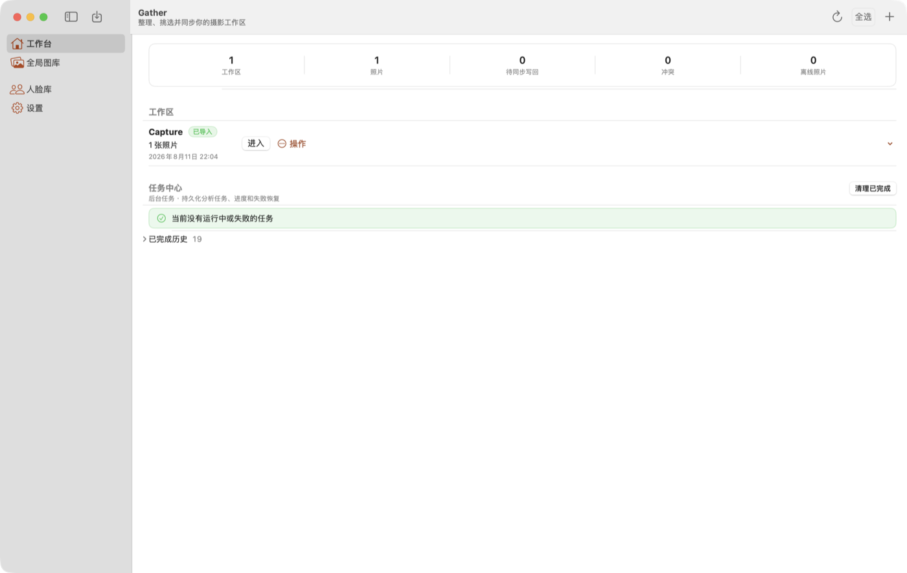
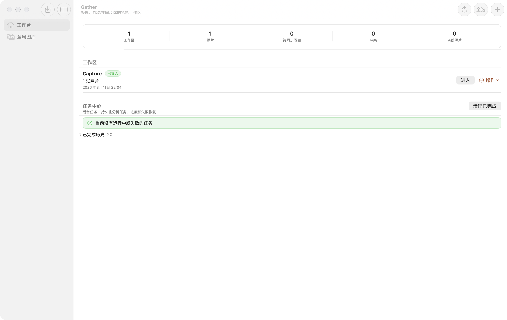
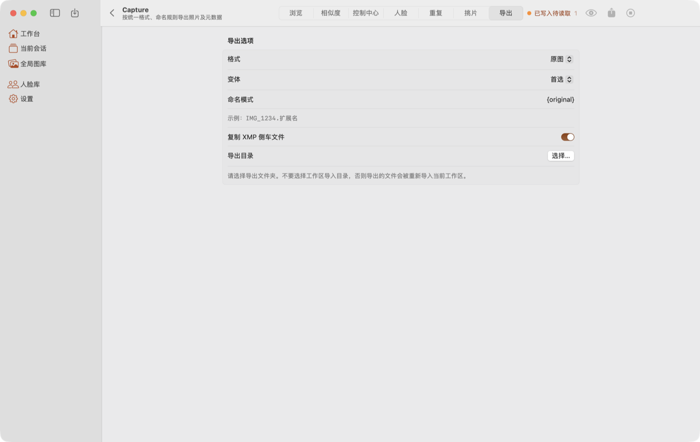
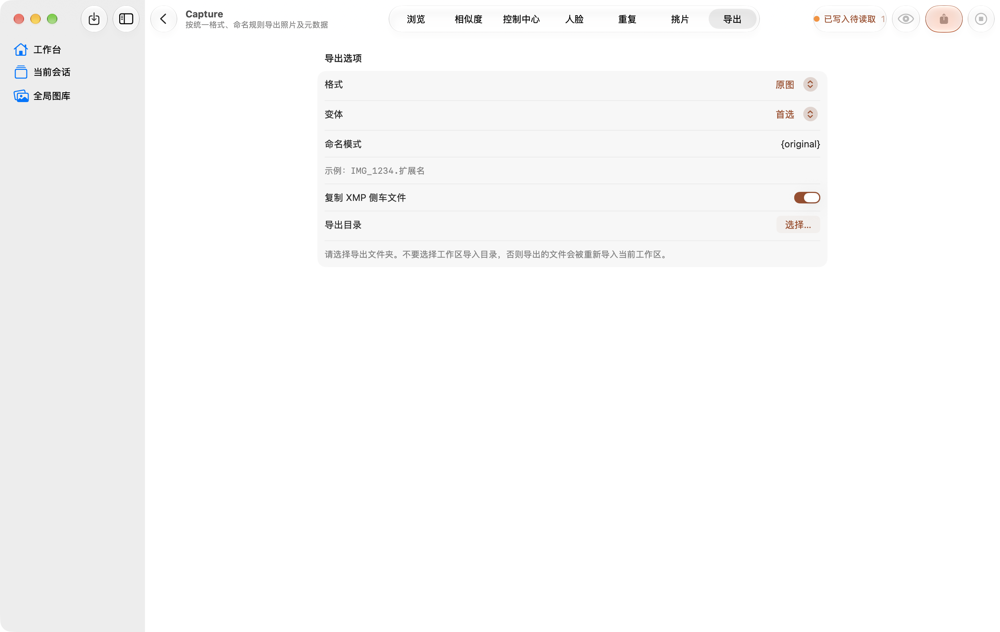
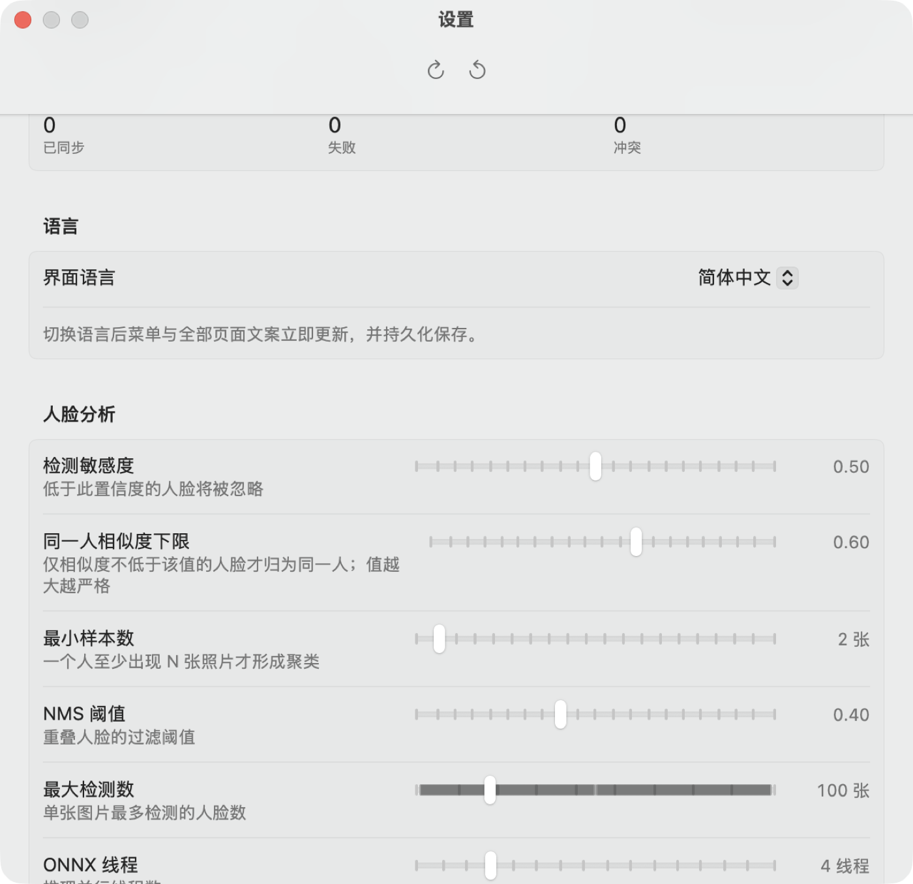
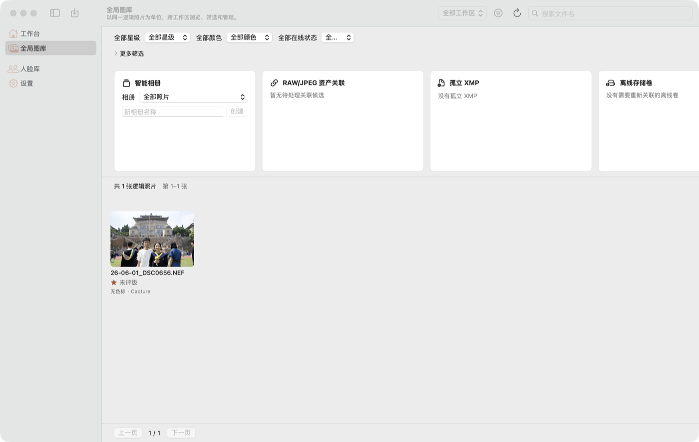
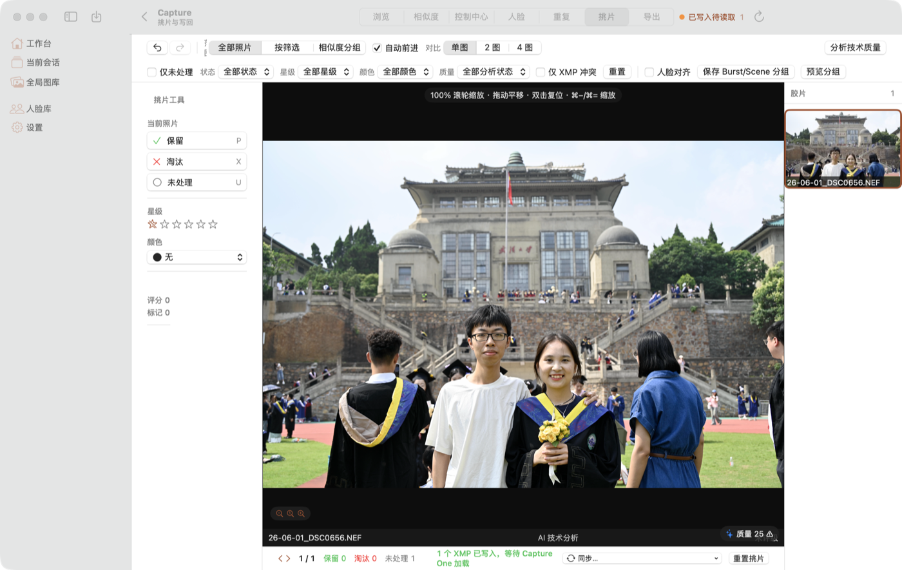
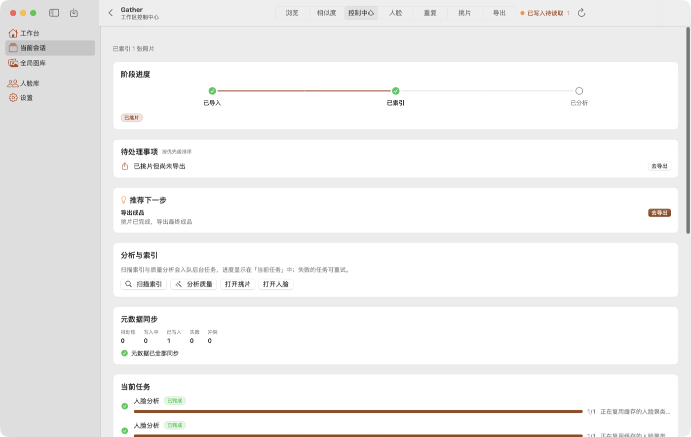
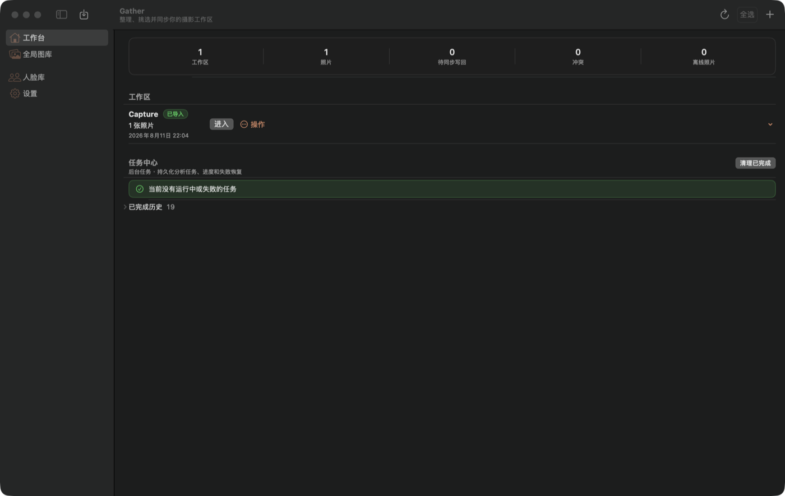
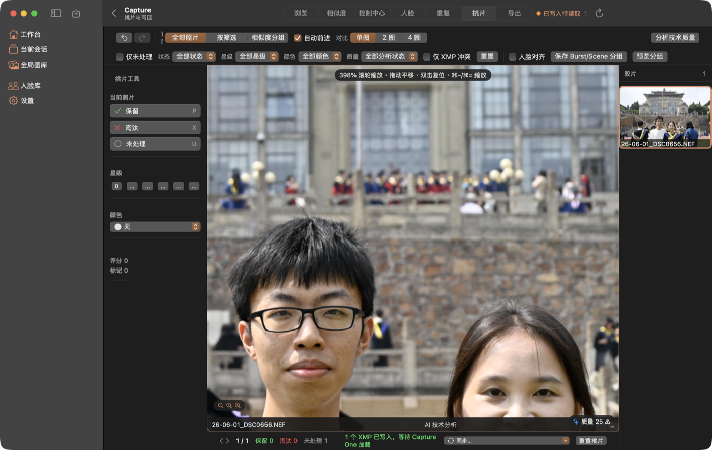

# Gather 原生化改造报告（去 CSS 设计系统 → 系统原生风格与控件）

> 对应评审：[视觉 / 页面 / 交互设计评审](visual-design-review.md)
> 范围：`desktop/native/gather-app` 全部视图层（外壳 + 10 个页面 + 共享组件）
> 验证：macOS 27.0 真机运行截图（见 [assets/native/](assets/native/) 与 [assets/native-liquid-glass/](assets/native-liquid-glass/)）+ 224 个应用测试全通过

---

## 0.0 先决问题：为什么一开始「像旧版 macOS」（已修复）

改造完成后界面虽然全是系统控件，外观却仍是 **macOS 15 及更早** 的样子
（矩形按钮、不透明侧栏、旧窗口圆角）——**根因不在 SwiftUI 代码，在构建产物的 Mach-O 头**：

```
$ vtool -show-build release/Gather.app/Contents/MacOS/Gather
      cmd LC_BUILD_VERSION
    minos 14.0
      sdk 14.0        ← 记的是**部署目标**，不是真实 SDK
```

SwiftPM 以 `-target arm64-apple-macosx14.0` 驱动编译，Swift driver 于是把
`-platform_version macos 14.0 14.0` 交给 ld。从 **macOS 26 起 AppKit 用这个字段做
linked-on-or-after 判定**：记成 `sdk 14.0` 的进程会被**强制渲染旧外观**——
哪怕链接的是 MacOSX27.0.sdk、跑在 macOS 27 上，Liquid Glass 一个都拿不到，
`glassEffect` 之类的新 API 也只会画出旧材质。

**修复**（`Package.swift`）：在 manifest 里用 `xcrun --show-sdk-version` 读出真实
SDK 版本，通过 `linkerSettings` 显式补上 `-platform_version macos <部署目标> <SDK 版本>`
（每个参数都要 `-Xlinker` 前缀，否则 swiftc 报 `unknown argument`）。
效果等同于 Xcode 工程自动生成的那行链接参数；`minos` 仍是 14.0，**仍可在 macOS 14 上运行**。

```swift
let macOSSDKVersion: String = { /* xcrun --show-sdk-version */ }()
let liquidGlassLinkerSettings: [LinkerSetting] = [
    .unsafeFlags([
        "-Xlinker", "-platform_version",
        "-Xlinker", "macos",
        "-Xlinker", macOSDeploymentTarget,   // 14.0
        "-Xlinker", designSDKVersion,        // 27.0
    ]),
]
```

修好后**整个 app 一次性切到 Liquid Glass**：工具栏按钮变成圆形玻璃胶囊、
侧栏变半透明、控件变胶囊、分隔线延伸到窗口边缘、窗口圆角加大。
开发者可用 `GATHER_SDK_VERSION=26.0 swift build` 覆盖，用于对比/回归。

| 旧外观（`sdk 14.0`） | Liquid Glass（`sdk 27.0`） |
| --- | --- |
|  |  |
|  |  |

---

## 0.0.1 自动生效 vs 手工接入

Apple 的规则是：**只要用标准系统组件，外观自动更新**；需要写代码的只有
「自定义玻璃表面」「边缘延伸」「工具栏分组」「同心圆角」这几类。因此本轮**只做
Apple 明确要求手工接入的部分**，不把玻璃滥用到内容层。

自动生效（无需代码，已验证）：`NavigationSplitView` 侧栏、`ToolbarItem` 工具栏、
按钮/开关/滑杆/选择器、`Form(.grouped)`、`List`、窗口与 sheet 圆角、滚动边缘效果、菜单。

手工接入（本轮新增 `Sources/GatherApp/Support/GatherGlass.swift`）：

| 能力 | API（可用性） | 用在哪儿 |
| --- | --- | --- |
| 功能层玻璃表面 | `glassEffect(_:in:)`（26.0） | toast、查看器缩放控件 |
| 主要动作按钮 | `.buttonStyle(.glassProminent)`（26.0） | 19 处主行动按钮（`gatherPrimaryActionButton()`，低版本回退 `.borderedProminent`） |
| 工具栏分组 | `ToolbarSpacer(.fixed, placement:)`（26.0） | 图库、导出页工具栏（筛选用一组、状态+刷新一组、设置一组） |
| 圆角同心 | `containerShape(_:)`（26.0） | 功能层容器（`gatherConcentricContainer`，留给后续嵌套控件） |

**刻意不做**的部分，以及依据：

- **卡片/列表行/表单行不加玻璃。** HIG《Materials》：「Don't use Liquid Glass in the
  content layer. … Instead, use standard materials for elements in the content layer.」
  `gatherCard()` 继续用 `controlBackgroundColor` + 系统分隔线。为防误用，
  `GatherGlass` 干脆**不提供**「把任意视图变玻璃」的通用入口。
- **不覆盖滚动边缘效果。** HIG《Scroll views》：「Prefer the automatic scroll edge effect
  style.」系统默认已是正确选择，手写 `.hard`/`.soft` 反而需要额外验证。
- **不加自己的工具栏溢出菜单。** `ToolbarOverflowMenu` **在 macOS 上不存在**
  （仅 iOS/iPadOS/visionOS 27），macOS 由系统自己提供。
- **不在 `NavigationSplitView`/侧栏/工具栏上画自定义底色。** Apple 明确要求
  「Reduce your use of custom backgrounds in controls and navigation elements」——
  这些底色会盖住系统材质和滚动边缘效果。本地改造时已全部移除。
- **媒体之上用 `.clear` 并自行暗化。** 挑片查看器的缩放控件浮在照片上，
  用 `glassEffect(.clear, in: .capsule)`；底下本来就有 `viewerChrome` 深色底，
  满足 Apple「亮媒体需要暗化层」的前提。
- **不用 `ConcentricRectangle` 改卡片圆角。** 同心半径是相对**最近**的圆角容器算的；
  卡片悬在窗口中部、离窗口角很远，算出来会被钳成 0（变成直角）。
  同心圆角只对「贴着容器角的嵌套元素」成立，所以只提供 `gatherConcentricContainer`
  给功能层容器用，没有套到卡片上。

**版本门控**：以上全部 `if #available(macOS 26.0, *)`，低版本回退到改造前的等价实现
（`.regularMaterial` + 分隔线 / `.borderedProminent` / 无工具栏分隔）。macOS 27 独有项
（`NSGlassEffectView.effectIsInteractive` 默认 `NO`、`ToolbarMinimizationBehavior`、
`TabRole.prominent`）本轮未使用——它们只影响 AppKit 玻璃视图的交互反馈与工具栏折叠，
当前界面没有对应场景。

**已核对但不需要用的**：`backgroundExtensionEffect()`（本 app 没有「内容要伸到侧栏下面」
的独立英雄图；挑片查看器两侧是页内分栏，镜像边缘反而会串到工具列）、
`scrollEdgeEffectHidden`、`toolbar(id:)` 自定义、`TabView(.sidebarAdaptable)`
（`NavigationSplitView` 已是 macOS 推荐结构）、`.visibilityPriority`（macOS 26.1 起，
工具栏项数量不足以触发溢出）。

---

## 0. 一句话


把一套**从 Web/Electron 逐像素翻译过来的 CSS 设计系统**整体移除，改用 macOS 系统语义色、
系统材质与系统控件。改造后：

| 平台能力 | 改造前 | 改造后 |
| --- | --- | --- |
| `.toolbar` / `ToolbarItem` | **0** | **16** 处 |
| `NavigationSplitView` | **0** | 外壳（侧栏 + 内容） |
| `Settings` scene（⌘, 独立设置窗口） | **0** | ✅ 已接入 |
| `.searchable` | **0** | **5** 处 |
| `ContentUnavailableView` | **0** | **31** 处 |
| `Form` + `.formStyle(.grouped)` | 1 处 | 设置 / 导出 / 新建工作区 / 人物 |
| 语义色 `Color(nsColor: …)` | **1** 处 | 全量（表面 / 文字 / 分隔线 / 状态色） |
| `.focusable(false)` 关闭键盘遍历 | **39** 处 | **0** |
| 26pt 手绘大标题 | **13** 处 | **0** |
| `.kerning()` / `.textCase(.uppercase)` | 3 处 | **0** |
| `NSEvent` 键盘监视器 | 3 处 | **0**（改 `.keyboardShortcut` / `.onKeyPress`） |
| 硬编码 hex 调色板 | 全套 | 仅品牌 accent + C1 色标数据 |

---

## 1. 前后对照

| | 改造前 | 改造后 |
| --- | --- | --- |
| 设置 |  |  |
| 工作台 |  |  |
| 全局图库 |  |  |
| 挑片工作台 |  |  |
| 导出 |  |  |
| 控制中心 |  |  |
| 深色工作台 |  |  |
| 深色挑片 |  |  |

---

## 2. 基础层：CSS 主题 → macOS 语义色

`Sources/GatherApp/Support/GatherTheme.swift` 整体重写：

| 旧 token | 新取值 | 说明 |
| --- | --- | --- |
| `background` | `.windowBackgroundColor` | 页面底色由窗口提供 |
| `surface` / `backgroundSecondary` | `.controlBackgroundColor` | 分组内容底色 |
| `border` | `.separatorColor` | 分隔线 / 描边 |
| `textPrimary` | `Color.primary` | |
| `success` / `warning` / `error` / `info` | `.systemGreen` / `.systemOrange` / `.systemRed` / `.systemBlue` | 自动适配深色与增强对比度 |
| `primary` | 品牌 accent（**只用于强调**） | 新增 `.accessibilityHighContrast*` 两态 |

关键修正：
- 品牌暖橙**不再**充当表面色或正文色（旧版卡片底色 / 边框 / 选中栏全部是它）。
- `GatherTheme.warning`（`#D4944F`，对比度 **2.41:1**）不再做正文前景色。
- 选中态改用 `.selectedContentBackgroundColor` + `.alternateSelectedControlTextColor`
  （旧版「白字压品牌色」在深色下只有 ≈2.7:1）。
- `GatherStatCard` 的状态色只落在**圆点/图标**上，数字恢复系统前景色
  （`.systemGreen`/`.systemRed` 当正文在浅色下只有 ~2:1）。

`gatherCard()` 重写为原生分组容器（`.controlBackgroundColor` + `.separatorColor` + 连续圆角 +
`maxWidth: .infinity`）——顺带修掉「语言卡片只有同列其它卡片 1/3 宽」的 P0。

---

## 3. 外壳：手搓侧栏 → NavigationSplitView

`RootView.swift` 重写：

- 侧栏改用 `NavigationSplitView` + `List(selection:).listStyle(.sidebar)`。
  删除手搓的 `Button` 行、`primarySoft` 圆角块、左侧 4pt 竖条、不透明 `gatherSurface` 底色、
  6pt 拖拽手柄与 `NSCursor.push()/pop()` —— 材质、选中高亮、列宽拖拽、⌘⌥S 全部交还系统。
- 页面改为**按目的地条件构建**（旧版全部 `.opacity(0)` 常驻），消除隐藏页状态泄漏、
  跨页快捷键污染与为了兜底而加的 `.disabled(false)`。
- 窗口最小尺寸 1100×720 → **860×560**，并加 `.defaultSize(1180×780)`。
- 窗口标题由 `.navigationTitle` 承载（会话页 = 会话名，页面型目的地由页面自设）。
- 新增真正的 `Settings` scene：⌘, 打开独立设置窗口（最小化/缩放自动变灰、位置与 pane 由系统记忆），
  入口是应用菜单里的「设置…」——与 Xcode / Safari / 访达一致。
  （**注意**：`showSettingsWindow:` 不在 AppKit SDK 中，最终实现走 SwiftUI 公开的
  `@Environment(\.openSettings)`，见 §7。）

`SessionTabBar` 从「7 个手搓 Button + 选中下划线」改为原生 `.pickerStyle(.segmented)`，
并由 `View.sessionPageChrome(...)` 放进工具栏 principal 位置。

---

## 4. 逐页改造

### 4.1 设置页（用户反馈项）

| 旧 | 新 |
| --- | --- |
| 主窗口里的一个页面，⌘, 只是切页 | **独立 `Settings` 窗口**（⌘, / 应用菜单） |
| `VStack` + `ScrollView` + 5 张自绘卡片 | `Form` + `.formStyle(.grouped)` + 9 个 `Section` |
| 手搓 `HStack` + `Spacer` + 四个魔法宽度（300/220/120/240）+ 900pt 空走廊 | 系统标签列 + 控件列自动对齐 |
| **每个字段一个「保存」按钮**（约 30 个） | 编辑即生效（`onSubmit`）；路径字段加原生「选择…」文件选择器 |
| ✓ / ✗ 文本字形 + 纯颜色信号 | `Label` + `checkmark.circle.fill` / `xmark.circle.fill` + 语义色 + `accessibilityValue` |
| 卡片/分组/子分区标题全是 15pt `.title3`（三级同号） | 标题走 `Section` 头，正文 13pt，说明 12pt |
| 6 格等权 `LazyVGrid` 队列计数 | 原生 `Grid`，失败/冲突有数值时才用语义色 |
| 模型目录不可选中、无出口 | 路径可选中复制 + 「在访达中显示」 |
| 滑杆行两套布局 | 统一 `LabeledContent` + 尾部数值 |
| 「恢复默认」与「刷新」外观相同 | 工具栏分组 + `.help`，确认弹窗保留唯一破坏性角色 |

### 4.2 工作台（Dashboard）
手绘头部 → `.navigationTitle`/`.navigationSubtitle` + 工具栏（刷新/全选/删除N/取消/新建）；
手搓多选（`selectMode` + 自绘 checkbox）→ `List(selection:)` + `.onDeleteCommand`；
空/错态 → `ContentUnavailableView` + 重试；手搓折叠 → `DisclosureGroup`；
新建工作区 sheet → `Form` + `LabeledContent`；会话 UUID 副标题 → 工作区名。

### 4.3 全局图库（Library）
手绘头部 → `.navigationTitle` + 工具栏；`.roundedBorder` 搜索框 → `.searchable(placement: .toolbar)`；
「更多筛选」→ `DisclosureGroup` + `LabeledContent`；空态拆成「真空库」与「筛选无结果」两条出口；
**修正「支持卡片横条」**：旧版是隐藏滚动条的固定宽度横条（280+320+320+300 = 1244pt），
最小窗口下「离线存储卷」整张卡在屏幕外且无任何提示 —— 改为自适应列数网格，任何宽度下四张卡都在视野内，
并去掉卡片内的第二层纵向滚动。

### 4.4 图库（Gallery）
头部四件套（返回 + 26pt 大标题 + 手绘页签栏 + 页头状态胶囊）→
`.sessionPageChrome` + 工具栏（返回在 `.navigation`、状态胶囊与刷新在 `.primaryAction`）；
`.roundedBorder` 搜索 → `.searchable`；手绘筛选/密度控件 → `Picker(.menu)`；
选中栏从「白字压品牌色」→ 系统选中色；新增**全选**与 **Esc 取消选择**；
右键菜单不再因「有选中」而变空；`NSEvent` 键盘监视器 → `.onKeyPress`（←/→）；
已废弃的 `MagnificationGesture` → `MagnifyGesture`；照片文件名遮罩加高加浓（亮照片上也可读）。

### 4.5 相似度 / 人脸关键词 / 重复 / 挑片 / 导出
- **相似度**：模式与预设手绘按钮 → `.segmented` Picker；分组网格从「内嵌 ScrollView + 70vh 固定高」
  改为 `LazyVGrid(.adaptive)` 自然高度（去掉嵌套滚动与手算行高）；进度 → 原生 `ProgressView`。
- **人脸关键词**：手绘步骤胶囊 → `.segmented` Picker；审核步骤从 `GeometryReader` + 340pt 魔法宽度
  → `HSplitView`；三层卡片 + 嵌套 210pt 滚动 → 单一滚动区 + `LabeledContent` 表单行；
  破坏性文字按钮命中区 ~16pt → 悬停图标按钮 ≥24pt + 右键菜单；删除 core 枚举（`done/failed/cancelled`）上屏。
- **重复**：两个 `confirmationDialog` 从同一视图节点拆开；**修复「保留」按钮标签与动作相反**；
  匹配强度手绘按钮组 → `.segmented`；空/失败态 → `ContentUnavailableView`；
  accessibility 从 **0 → 6** 处；只改数据库标记的可逆操作不再使用破坏性角色。
- **挑片**：**删除 39 处 `.focusable(false)`**（Tab 遍历恢复）；键盘从 `NSEvent` 监视器改为
  可见控件的 `.keyboardShortcut`（P/X/U、0–5、←/→、⌘−/⌘0/⌘=）与查看器 `.onKeyPress(.space)`；
  加载失败不再渲染空白黑三栏，改 `ContentUnavailableView` + 重试；
  星级文字按钮（在 214pt 工具列里被压成「…」）→ 累计填充的图标星标；
  色标手绘圆点 → `.menu` Picker；胶片条星级的 warning 正文色 + 阴影 → 查看器前景色 + 深色胶囊。
- **导出**：**消除「格式 格式 / 变体 变体」重复标签**（`Picker` 加 `.labelsHidden()`）；
  选项区改 `Form` + `.formStyle(.grouped)`；`NSOpenPanel.runModal()` → 非阻塞 `begin()`；
  空间不足警告从 2.41:1 的正文色 → `NativeBanner`。

### 4.6 控制中心 / 人物库
- **控制中心**：阶段进度重写为「等宽列 + 列内左右两段连接线 + ZStack 共用圆心」——
  旧版连接线按相邻标题宽度分配空间，必然错位；任务行补逐状态图标、
  `GatherBadge(status:)` 与进度条，文案改为真实可用的操作；卡片宽度统一 `maxWidth: .infinity`。
- **人物库**：保留 `Form + .formStyle(.grouped)` 作为全 app 表单的目标形态；
  列表从手绘选中行 → `List(selection:).listStyle(.sidebar)`；搜索 → `.searchable`；
  固定 300pt 分栏 → `HSplitView`；四处自绘空/错态 → `ContentUnavailableView`；
  硬编码头像 RGB → accent 淡化底 + 系统前景色。

---

## 5. 交互与可访问性

- **删除全部 39 处 `.focusable(false)`** 与私有 `nonFocusable()` 扩展：macOS 的 Tab 遍历是系统级无障碍能力。
- `NSEvent` 键盘监视器 **3 → 0**：改 `.keyboardShortcut` / `.onKeyPress`（macOS 14+）。
- 排版：`.footnote`(10pt) 不再承载计数/文件名/状态；`.kerning` 与 `.textCase(.uppercase)` 归零
  （拉丁排版手段不适用于中日韩文字）。
- 可访问性：`List` 行改 `.accessibilityElement(children: .combine)`（旧版用
  `.accessibilityLabel` 把行内容整个盖掉）；图标按钮补 `.help`；状态全部有 `accessibilityValue`。
- 破坏性角色语义收紧：只有真正不可撤销的动作（恢复默认设置、覆盖模型文件、删除人物/相册/写回备份）
  使用 `.destructive`；可逆的数据库标记改用普通角色，避免稀释信号。

---

## 6. 顺带修掉的功能缺陷

| 缺陷 | 位置 | 结果 |
| --- | --- | --- |
| 导出页「格式 格式 / 变体 变体」 | `ExportView` | ✅ 修复 |
| 「语言」卡片只有同列卡片 1/3 宽 | `gatherCard()` | ✅ 修复 |
| 图库「离线存储卷」卡在屏幕外且无滚动条提示 | `LibraryView.supportPanel` | ✅ 修复 |
| 挑片星级被压成「…」 | `CullingView` | ✅ 修复 |
| 挑片加载失败渲染空白黑色三栏 | `CullingView` | ✅ 修复 |
| 图库右键菜单在有选中时为空 | `GalleryView` | ✅ 修复 |
| 空库与「筛选无结果」共用错误文案 + 禁用按钮 | `LibraryView` | ✅ 修复 |
| 控制中心阶段连接线错位 | `SessionControlView` | ✅ 修复 |
| 重复页「保留」按钮标签与动作相反 | `DuplicatesView` | ✅ 修复 |
| 5 个页面把会话 UUID 当副标题 | 多处 | ✅ 移除 |
| 切语言后设置窗口不刷新 | `SettingsView` | ✅ 由 `@Observable` 驱动 |
| 性能：每次本地化查找都新建 `Bundle` | `GatherLocalization.l()` | ✅ 加锁缓存（滚动掉帧的主因之一） |

---

## 7. 需要留意的实现约束（后续维护）

1. **不要用 `showSettingsWindow:`**：它不在 AppKit SDK / Swift 接口里（`grep` 可证），
   是 SwiftUI 私有 selector。打开设置窗口请用 `@Environment(\.openSettings)`（macOS 14+），
   菜单项经 `GatherAppNotification.menuOpenSettings` 通知转发。
2. **部署目标是 macOS 14**：`ContentUnavailableView` / `MagnifyGesture` / `onKeyPress` /
   `defaultFocus` 可用；Liquid Glass 系列（`glassEffect` / `.buttonStyle(.glass)` /
   `backgroundExtensionEffect` / `scrollEdgeEffectStyle`）是 **macOS 26+**，必须 `if #available`。
3. **测试契约**：`RootNavigation`（含 `WebPage.allCases == ["persons", "settings"]`）、
   `SessionTab.allCases` 顺序、`SessionControlView.stageMarks(_:)` 均保持不变——
   迁移后 224 个应用测试全通过。
4. 设置不再占用侧栏条目（macOS 惯例：应用菜单「设置…」）。`.page(.settings)` 仍可渲染，
   供程序化路由使用。

---

## 8. 验证

- **构建**：`swift build -c debug --disable-sandbox` → 0 error。
- **测试**：`swift test --disable-sandbox` → **224 tests / 27 suites 全通过**。
- **英文文案**：补齐 125 条缺失的 en 表条目，`GatherLocalization.l()` 用到的 992 个中文 key 现在 100% 有英文翻译。
- **真机截图**：17 张（浅色 11 + 深色 6），见 [assets/native/](assets/native/)。
  覆盖工作台 / 设置窗口 / 全局图库 / 人脸库 / 图库 / 控制中心 / 相似度 / 人脸关键词 /
  重复 / 导出 / 挑片，以及深色下的工作台 / 图库 / 挑片 / 导出 / 人脸 / 人物库。
- 截图临时运行时钩子（页面直达 / 外观 / 窗口尺寸）**已全部删除**，`grep ReviewHarness` 无残留。

## 9. 未完成 / 有意保留

1. **图库点击语义**仍是「⌘/⌃ 单击 = 多选，单击 = 打开查看器」，未改成 Finder 的「单击选中 / 双击打开」。
   这是一处**交互语义变更**，会牵动查看器入口与无障碍语义，需要单独一轮设计与回归，本轮未做。
   已补的出口：右键菜单、全选、Esc 取消选择、`.accessibilityLabel/Value`。
2. **挑片胶片条多选**仍读 `NSEvent.modifierFlags`：ViewModel 没有集合写入 API
   （只有 `selectCurrent`/`toggleSelection`/`clearSelection`），`List(selection:)` 无法无损映射；
   键盘遍历与无障碍已达标。
3. **滚轮缩放**保留非键盘的 `NSEvent .scrollWheel` 局部监视器：macOS 14 的 SwiftUI 无原生滚轮 API。
4. **ViewModel 层**的评审项（主线程同步命令、仪表盘 N+1 刷新、重试风暴）不在本次视图层改造范围内。
