# Gather macOS 视觉 / 页面 / 交互设计评审

> 评审对象：Gather 原生 macOS 应用（SwiftUI，部署目标 macOS 14，包 `desktop/native/gather-app`）
> 评审环境：macOS 27.0（26A428）/ Xcode 27.0 / Swift 6.4，设备 MacBook（1512×982 pt，Retina）
> 评审方式：**源码全量走查 + 真机 GUI 截图**（浅色与深色两套）。与应用现有 [ux-review.md](ux-review.md) 不同，本评审**实际运行了 GUI 并逐页截图**，所有"屏幕可见"结论均可由附录 A 的截图复核；所有代码级结论附 `文件:行号`。
> 参照基准：Apple Human Interface Guidelines（含 2025-09 更新的 Liquid Glass 章节）。
>
> **状态更新**：本报告的 5 个根因、16 条 P0 与绝大部分 P1 已在[原生化改造报告](native-refactor-report.md)中落地；改造后的真机截图见 [assets/native/](assets/native/)。

---

## 0. 结论

Gather 的**功能密度与工程纪律明显高于同类桌面工具**：破坏性动作统一走确认门控、写回影响面清单做到逐文件 diff、缩略图解码有并发闸门与 LRU 上限、Reduce Motion 在共享组件里被尊重。这些是真正的优势，**评审中不建议改动**（见 §8）。

但**外观与交互的"原生度"是当前最大的短板，而且是系统性的**：整份代码库对 macOS 平台能力的采用几乎为零。

| 平台能力 | 全 app 命中次数 | 说明 |
| --- | --- | --- |
| `.toolbar` / `ToolbarItem` | **0** | 所有窗口操作按钮都画在内容区 |
| `NavigationSplitView` / `NavigationStack` | **0** | 侧栏、页签、返回全部手搓 |
| `Settings` scene / `SettingsLink` | **0** | ⌘, 只切换主窗口内容 |
| `.searchable` | **0** | 搜索框是普通 `TextField` |
| `.inspector` / `Table` / `ContentUnavailableView` | **0** | 用自绘卡片与自绘空态替代 |
| `Material` / `glassEffect` / `NSVisualEffectView` | **0** | 全部为不透明硬编码色块 |
| `.commands` / `CommandGroup` | **0** | 快捷键藏在零尺寸透明按钮里 |
| `Color(nsColor: .windowBackgroundColor / .controlBackgroundColor / .separatorColor …)` | **1**（仅 `CullingView.swift:1964`） | 其余约 25 处为硬编码 hex |

一句话概括：**这是一个被原生化外壳包住的 Web/Electron 界面**。它的栅格、间距、圆角、悬停、分隔线、进度条、分段控件、侧栏、页签、面包屑、大标题，全部是 CSS 设计系统在 SwiftUI 里的逐像素翻译。在 macOS 26/27 的 Liquid Glass 语境下，这种"不透明平面色块 + 手绘控件"的组合正是"看起来过时"的最大单一来源。

用户提到的"设置页还在用很丑的原生输入框"只是这个根因的一个局部显影：**一个自绘暖色卡片系统里，突然掉进一个 Aqua 时代的 `.roundedBorder` 文本框，两边都没有让步**。§3 对设置页做了专项拆解。

### 严重度分布

| 级别 | 数量 | 含义 |
| --- | --- | --- |
| **P0** | 16 | 屏幕上肉眼可见的破版 / 对比度不合格 / 关键状态不可达 |
| **P1** | 60+ | 明确的 HIG 与平台惯例违背，用户会感到"这不是 Mac 软件" |
| **P2** | 45+ | 一致性、打磨、可访问性细节 |

---

## 1. 五个系统性根因

后面绝大多数条目都可以追溯到这五条。修根因的性价比远高于逐条修症状。

### R1 · 主题是 CSS 设计系统，不是 macOS 设计系统

[GatherTheme.swift:9-46](../../desktop/native/gather-app/Sources/GatherApp/Support/GatherTheme.swift#L9-L46) 定义了整套硬编码 sRGB hex；[:52-57](../../desktop/native/gather-app/Sources/GatherApp/Support/GatherTheme.swift#L52-L57) 的 dynamic provider 只区分 `.aqua` / `.darkAqua`：

~~~swift
let isDark = appearance.bestMatch(from: [.darkAqua, .aqua]) == .darkAqua
return NSColor(hex: isDark ? dark : light)
~~~

- **从不查询** `.accessibilityHighContrastAqua` / `.accessibilityHighContrastDarkAqua` —— 用户在系统里打开「增强对比度」，本 app 毫无反应。
- **从不使用** `Material`、`.windowBackgroundColor`、`.controlBackgroundColor`、`.separatorColor`、`.labelColor`。所有表面都是不透明色块，因此 macOS 26 的 vibrancy / Liquid Glass 分层完全不会发生。
- HIG *Color* 明确要求：**"Avoid hard-coding system color values in your app"**、**"Make sure all your app's colors work well in light, dark, and increased contrast contexts"**。
- 卡片与页面背景的实测对比度只有 **1.06:1**（`#FAF7F2` vs `#F5F0EB`），边框 **1.32:1**。截图里设置页读起来是"一片平坦的米色 + 漂浮的标题"，卡片边界几乎消失（对照 [设置页截图](assets/04-settings-fields.png)）。
- [RootView.swift:248](../../desktop/native/gather-app/Sources/GatherApp/RootView.swift#L248) 的 `.tint(GatherTheme.primary)` 进一步**覆盖了用户的系统强调色**，而 HIG *Sidebars* 明确要求侧栏图标应遵循 `controlAccentColor`。

### R2 · 外壳没有窗口级 chrome 契约

[GatherApp.swift:25-62](../../desktop/native/gather-app/Sources/GatherApp/GatherApp.swift#L25-L62) 只有一个 `WindowGroup`，没有 `Settings` scene；全 app 没有一处 `.toolbar`。结果是**每个页面都在内容区自绘一套假标题栏**：

- 26pt `.largeTitle.weight(.bold)` 页面大标题（**13 处**：`DashboardView.swift:149`、`LibraryView.swift:98`、`GalleryView.swift:190`、`SettingsView.swift:1088`、`CullingView.swift:1612`、`ExportView.swift:479`、`DuplicatesView.swift:476`、`SimilarityView.swift:245`、`FaceKeywordingView.swift:1047`、`SessionControlView.swift:313`、`PersonsView.swift:97`、`:294`、`:433`）—— macOS 窗口不存在 iOS 式大标题。
- 内容区里的 `chevron.left` 返回按钮（`CullingView.swift:1610`、`ExportView.swift:477`、`DuplicatesView.swift:474`、`FaceKeywordingView.swift:1045`、`SessionControlView.swift:311`、`PersonsView.swift:276`）。
- 手搓页签栏 [SessionTabBar.swift:22-83](../../desktop/native/gather-app/Sources/GatherApp/Support/SessionTabBar.swift#L22-L83)。
- 右上角 C1 状态胶囊常驻内容区（[C1StatusCapsule.swift:141-183](../../desktop/native/gather-app/Sources/GatherApp/Support/C1StatusCapsule.swift#L141-L183)）。

**四个页面的头部布局互不相同**（设置页有 `Color.gatherSurface` 色带；人脸页没有色带，色带只从步骤条开始；控制中心有色带；人物页干脆没有页头），所以同一个 app 看起来像四个 app。

HIG *Toolbars*：**"In a macOS app, the toolbar resides in the frame at the top of a window"**；*Settings*（macOS）：**"your custom settings window opens … contains a toolbar that includes buttons for switching between views"**。

### R3 · 平台控件被手搓替代

| 应有控件 | 实际实现 | 位置 |
| --- | --- | --- |
| `TabView` / 分段 `Picker` | 手搓 7 个 `Button` + 选中下划线 | `SessionTabBar.swift:46-83` |
| `List(selection:)` 侧栏 | 手搓 `Button` + `primarySoft` 圆角块 + 左侧 4pt 竖条 | `RootView.swift:543-582` |
| 侧栏拖拽调宽 | 手搓 `DragGesture` + `NSCursor.push()/pop()` | `RootView.swift:359-384` |
| `ProgressView` / `Gauge` | `GeometryReader` + 两个 `RoundedRectangle` | `GatherCommonViews.swift:79-145` |
| `DisclosureGroup` | 整行 `Button` 切换布尔值，无 chevron | `DashboardView.swift:317-339` |
| 搜索框（`NSSearchField`） | `.roundedBorder` 的 `TextField` | `GalleryView.swift:287`、`LibraryView.swift:126`、`PersonsView.swift:112` |
| 分段控件（匹配强度等） | 手绘 pill + 手绘选中底 | `SimilarityView.swift:293-303`、`FaceKeywordingView.swift:1236-1268`、`DuplicatesView.swift:529-539` |
| 复选框三态 | `square` / `checkmark.square.fill` / `minus.square` 图标 | `DashboardView.swift:188-192` |
| `Form` + `LabeledContent` | 手搓 `HStack` + `Spacer` + 魔法宽度 | `SettingsView.swift:1465-1531`、`ExportView.swift:584-715` |
| `List(selection:)` 多选 | 手搓 + `NSEvent.modifierFlags` 轮询 | `CullingView.swift:2685`、`GalleryView.swift:436-443` |

**全 app 唯一的 `Form` + `.formStyle(.grouped)` 在 [PersonsView.swift:354](../../desktop/native/gather-app/Sources/GatherApp/Persons/PersonsView.swift#L354)** —— 而在截图里，恰恰是人物详情那一块最像原生 Mac 软件。这本身就是最好的证据。

### R4 · 排版层级扁平，且大量使用 macOS 的**最小可读字号**

按 HIG *Typography* 的 macOS 规格：LargeTitle 26 / Title1 22 / Title2 17 / Title3 15 / Headline 13 Bold / Body 13 / Callout 12 / Subheadline 11 / **Footnote 10** / Caption 10。macOS 的**默认字号是 13pt，最小 10pt**。

代码里 `.footnote` 被当作通用正文使用（状态、说明、错误、计数、徽标），也就是**长期贴着平台可读性下限**：

- `CullingView.swift:2066-2069` 保留/淘汰/未处理计数 = 10pt
- `SettingsView.swift:1473` 字段说明 = 10pt
- `LibraryView.swift:668` 文件名（卡片主标识）= 10pt
- `GatherBadge.swift:50-52` 状态徽标 = 10pt + `.textCase(.uppercase)` + `.kerning(0.5)`
- `CullingView.swift:3155` 分组标签 = 10pt + `.kerning(0.4)`
- `SessionControlView.swift:817` 任务进度 `3/120` = 10pt

同时层级被压缩：设置页的卡片标题、分组标题、子分区标题**全部**是 `.title3.weight(.semibold)`（15pt，共 7 处：`SettingsView.swift:1108 / 1279 / 1368 / 1392 / 1400 / 1451`），而正文行标签是 12pt、说明是 10pt —— 三级之间只差 2–3pt，扫读时无法区分层级（对照 [设置页字段区截图](assets/04-settings-fields.png)）。

另一个纯中文语境的错误：**`.kerning()` / `.textCase(.uppercase)` 是从 CSS `letter-spacing` 直译过来的拉丁字母排版手段，套在中日韩文字上只会破坏字面节奏**（`GatherBadge.swift:51-52`、`CullingView.swift:1891 / 2203 / 3155`）。Apple 自己的中文界面从不加字距。

### R5 · 中文界面里泄漏内部标识符

5 个页面把会话 UUID 前 8 位当作用户可见副标题：

~~~
工作区 f7ca9127
~~~

`CullingView.swift:1613`、`FaceKeywordingView.swift:1048`、`ControlCenter/SessionControlView.swift:314`、`ExportView.swift:480`、`DuplicatesView.swift:477`。

对照截图 [挑片页](assets/02-culling.png)、[导出页](assets/08-export.png)，页面标题下方就是这行 UUID。用户不认识它，也不能用它做任何事。会话名在 `RootView.swift:392-394` 已经解析好了，直接用即可。

---

## 2. P0：屏幕上肉眼可见的问题

### P0-1 · 导出页把「格式」/「变体」标签打印了两遍

[ExportView.swift:587-600](../../desktop/native/gather-app/Export/ExportView.swift#L587-L600)

~~~swift
Text(GatherLocalization.l("格式")).font(.callout).frame(width: 60, alignment: .trailing)  // L589
Picker(GatherLocalization.l("格式"), selection: $viewModel.format) { ... }                // L590，未 labelsHidden
~~~

`Picker` 自带可见标签 + 旁边还有一个 `Text` 标签 = 屏幕上出现 **"格式 格式"** 与 **"变体 变体"**。截图 [08-export.png](assets/08-export.png) 可直接看到。

**修**：`Picker(...).labelsHidden()`，或删掉前置 `Text`。

### P0-2 · 设置页卡片宽度不一致，同一列里有的卡片只有别人 1/3 宽

[SettingsView.swift:1035-1044](../../desktop/native/gather-app/Settings/SettingsView.swift#L1035-L1044)

~~~swift
VStack(alignment: .leading, spacing: 20) {
    modelCard; c1HealthCard; languageCard; faceAnalysisCard; groupsCard
}
~~~

`gatherCard()`（[GatherTheme.swift:75-85](../../desktop/native/gather-app/Sources/GatherApp/Support/GatherTheme.swift#L75-L85)）只加 `padding(18)` + 背景 + 边框，**没有 `.frame(maxWidth: .infinity)`**，所以卡片宽度由内容决定。「语言」卡片内容窄 → 卡片窄。截图 [03-settings-top.png](assets/03-settings-top.png) 中「语言」卡片明显比上方两张窄。

同样的问题在控制中心：「分析与索引」和「元数据同步」两张卡片比同列的其它卡片窄（[09-control-center.png](assets/09-control-center.png)）。

**修**：`gatherCard()` 里加 `.frame(maxWidth: .infinity, alignment: .leading)`。

### P0-3 · 设置页字段区：900pt 的空白走廊 + 每个字段一个「保存」按钮

[SettingsView.swift:1465-1531](../../desktop/native/gather-app/Settings/SettingsView.swift#L1465-L1531)

~~~swift
HStack(alignment: .top, spacing: 12) {
    VStack(alignment: .leading, spacing: 2) { /* 标签 + 说明 */ }
    Spacer(minLength: 16)                            // L1476 把控件推到最右
    Group { /* TextField / Picker */ }
        .frame(maxWidth: 440, alignment: .trailing)  // L1528
}
~~~

截图 [04-settings-fields.png](assets/04-settings-fields.png) 显示：标签在 x≈280，控件在 x≈1200，中间 **~900pt 是空的**；每行右端都跟着一个「保存」按钮（约 30 个字段 ≈ 30 个按钮），右边缘呈锯齿；四个不同的魔法宽度（`300` / `220` / `120` / `240`，见 `:1486 / :1498 / :1525` 与 `:1212 / :1380`）导致控件左边缘参差。

HIG *Settings*：**"Minimize the number of settings you offer"**；标准 macOS 偏好设置是**标签列 + 控件列自动对齐**，且**编辑即生效**，不会逐行放按钮。

**修**：`Form { Section { LabeledContent("内存缓存条目数") { TextField(...).onSubmit(save) } } }.formStyle(.grouped)`（macOS 13+）。`Form` 会接管标签列、右边缘对齐、行内边距与无障碍关联。

### P0-4 · 设置页把「✓ / ✗」当图标用，且没有无障碍值

[SettingsView.swift:1346-1357](../../desktop/native/gather-app/Settings/SettingsView.swift#L1346-L1357)

~~~swift
ZStack {
    Circle().fill(passed ? GatherTheme.success.opacity(0.14) : GatherTheme.error.opacity(0.12))
    Text(passed ? "✓" : "✗").font(.footnote.weight(.bold))     // L1351
}.frame(width: 16, height: 16)
~~~

- `✓` / `✗` 是**文本字形**而非 SF Symbol，字号/字重随字体回退漂移，`✗` 不是标准符号。
- 状态完全由**颜色 + 字形**表达，VoiceOver 会把它和后面的「Capture One 可达」读成两段互不相关的元素，**永远不播报"通过/未通过"**。
- 16pt 圆 + 10pt 粗体字形，视觉上挤在一起。

HIG *Color*：**"Avoid relying solely on color to differentiate between objects, indicate interactivity, or communicate essential information."**

**修**：

~~~swift
Label(zh, systemImage: passed ? "checkmark.circle.fill" : "xmark.circle.fill")
    .symbolRenderingMode(.hierarchical)
    .foregroundStyle(passed ? Color(nsColor: .systemGreen) : Color(nsColor: .systemRed))
    .accessibilityValue(passed ? "通过" : "未通过")
~~~

### P0-5 · 警告色 `#D4944F` 作正文前景色，对比度 **2.41:1**（AA 要求 4.5:1）

`GatherTheme.warning`（浅色 `#D4944F`）被当成**文字颜色**使用：

| 位置 | 内容 |
| --- | --- |
| `ExportView.swift:743-745` | 磁盘空间不足警告（唯一一条防止写满硬盘的提示） |
| `CullingView.swift:2704-2710` | 胶片条星级 `rating★`，压在照片上 + 一层阴影（阴影不是对比度手段） |
| `FaceKeywordingView.swift:1667` | 「未绑定并跳过」的 24pt 统计数字 |
| `WritebackReportCard.swift:46` | 「已跳过」统计 |
| `LibraryView.swift:761-770` | 评分星（作者已注意到对比问题并做了深色变体，但没有系统化） |

**修**：永远不要把 `warning` 当文字色。改用 `Color(nsColor: .systemOrange)`，或 `Label` + `exclamationmark.triangle.fill` + `.background(.orange.opacity(0.15), in: RoundedRectangle(...))`，并把 `GatherBadge(tone: .warning)`（自带描边）作为唯一警告样式。

### P0-6 · 胶片条列比它自己的缩略图还窄，每一张缩略图都被裁切

[CullingView.swift:1641-1659](../../desktop/native/gather-app/Culling/CullingView.swift#L1641-L1659)、[:2697](../../desktop/native/gather-app/Culling/CullingView.swift#L2697)、[:2241](../../desktop/native/gather-app/Culling/CullingView.swift#L2241)

~~~swift
let stripWidth = min(196, max(180, geometry.size.width * 0.15))   // L1641 上限 196
...
PhotoThumbnailView(...).frame(width: 180, height: 122)            // L2697 固定 180
// LazyVStack ... .padding(8)                                     // L2241 → 需要 196
~~~

仅当内容宽度 ≥1307pt（窗口 ≈1513pt）时列宽才够；在 app 的最小窗口 1100pt 下，列宽 180pt，**每张缩略图左右各被裁 8pt，2pt 选中描边和文件名一起被切掉**。而且裁切量随窗口大小变化，永远看起来不是刻意设计。

### P0-7 · 挑片工具列被自己的控件撑爆，星级与色标在**任何**窗口尺寸下都被裁

[CullingView.swift:1640-1644](../../desktop/native/gather-app/Culling/CullingView.swift#L1640-L1644)、[:2030](../../desktop/native/gather-app/Culling/CullingView.swift#L2030)、[:1918-1972](../../desktop/native/gather-app/Culling/CullingView.swift#L1918-L1972)

~~~swift
let toolsWidth = min(214, max(190, geometry.size.width * 0.17))   // L1640
...
.padding(.horizontal, 24)                                        // L2030 → 内部只剩 166pt
~~~

星级行 = 6 个 26pt 按钮 + 5×6pt 间距 = **186pt**；色标行 = 8 个 18pt 圆点 + 7×4pt = **172pt**。两者都在纵向 `ScrollView` 里，溢出被静默裁掉。对照截图 [02-culling.png](assets/02-culling.png) 左侧工具栏 —— 第 5 颗星和最后一个色标是缺的。

### P0-8 · 挑片页工具栏第二行是**隐藏了滚动条**的横向滚动区

[CullingView.swift:1722-1816](../../desktop/native/gather-app/Culling/CullingView.swift#L1722-L1816)

~~~swift
ScrollView(.horizontal, showsIndicators: false) {   // L1722
    HStack(spacing: 10) { /* 4 个带标签的 popup、3 个复选框、分隔线、8 个按钮 */ }
~~~

这一行控件总宽 **>1300pt**，而最小窗口下内容宽度只有 ≈894pt。`showsIndicators: false` 把**唯一**提示"还有更多控件"的线索也去掉了 —— 导航分组控件在常见窗口尺寸下**根本不可发现**。

HIG *Toolbars*：**"The system automatically adds an overflow menu in macOS … Don't add an overflow menu manually, and avoid layouts that cause toolbar items to overflow by default."** macOS 工具栏是溢出成 chevron 菜单，不是横向滚动。

### P0-9 · 挑片页加载失败 → 渲染一个**空白黑色三栏工作台**

[CullingView.swift:1427-1443](../../desktop/native/gather-app/Culling/CullingView.swift#L1427-L1443)

~~~swift
} else if viewModel.page == nil && viewModel.errorMessage == nil { /* 转圈 */ }
} else { workbench }   // L1441 出错时 page 仍为 nil，直接落到这里
~~~

`culling.list_page` 抛错时 `page` 保持 nil 且只设置 `errorMessage`（`:815-817`），于是控制流落到 `workbench` 分支：空工具栏 + 空查看器（`#202020` 矩形）+ 空胶片条 + 无数据信息栏。**用户看到的是一个没有解释的黑色矩形**，唯一的恢复手段是页头那个小刷新按钮。

**修**：补第四个分支，用 `ContentUnavailableView`（macOS 14+）显示错误与重试。

### P0-10 · 全局图库支持卡片横条：1304pt 内容塞进 894pt，滚动条被隐藏

[LibraryView.swift:195-212](../../desktop/native/gather-app/Sources/GatherApp/Library/LibraryView.swift#L195-L212)

~~~swift
ScrollView(.horizontal, showsIndicators: false) {   // L196
    smartAlbumsCard.frame(width: 280)               // L198
    assetCandidatesCard.frame(width: 320)
    metadataOrphansCard.frame(width: 320)
    offlineVolumesCard.frame(width: 300)
~~~

280+320+320+300 + 3×12 + 2×24 = **1304pt**；最小窗口减去 200pt 侧栏 + 6pt 拖拽条后只剩 ≈894pt。**「离线存储卷」整张卡 + 半个「孤立 XMP」在屏幕外**，而 `showsIndicators: false` 让用户不知道它们存在。已实现的功能因此不可达。截图 [10-library.png](assets/10-library.png) 里第 4 张卡片只露出一条边。

### P0-11 · 全局图库：空库与"筛选无结果"共用一套空态，且按钮是**禁用的**

[LibraryView.swift:599-615](../../desktop/native/gather-app/Sources/GatherApp/Library/LibraryView.swift#L599-L615)

~~~swift
Text("没有符合条件的照片")
Text("调整或清除筛选条件以查看全部照片")
Button("清除筛选") { viewModel.clearFilters() }
    .disabled(viewModel.activeFilterCount == 0)      // 从未导入过照片时 → 灰掉
~~~

首次启动、库里一张照片都没有的用户，看到的是"没有符合条件的照片"这句**错误的文案** + 一个**灰掉的按钮**，从这一页无路可走。这是浏览类界面最重要的状态，却是最弱的一个。

**修**：`ContentUnavailableView`（macOS 14+）分两支 —— 真空库给「新建工作区 / 导入文件夹」；筛选无结果给永远可点的「清除筛选」。

### P0-12 · 图库选中栏：深色模式下白字压在亮橙上（≈2.7:1）

[GalleryView.swift:336-356](../../desktop/native/gather-app/Sources/GatherApp/Gallery/GalleryView.swift#L336-L356)

~~~swift
.foregroundStyle(.white)                              // L340/L348
.background(Capsule().fill(Color.white.opacity(0.2))) // L351 → 白 on 白@20% on 橙
.background(GatherTheme.primary)                      // L355 → 深色下是 #D98964（亮橙）
~~~

调色板在深色模式下会把主色**提亮**成 `#D98964`，但文字仍是纯白。AA 要求 4.5:1，大字号 3:1，实测约 **2.7:1**；「取消选择」胶囊更差（浅色 ≈3.8:1 / 深色 ≈2.2:1）。**这是 app 的主选中反馈，也是它唯一的退出通道。**

**修**：不要手工配"白 + 品牌色"。用 `Color(nsColor: .selectedContentBackgroundColor)` / `.selectedContentTextColor`，或 `.regularMaterial` 背景 + `.primary` 文字。

### P0-13 · 图库选中之后，右键菜单是空的

[GalleryView.swift:452-458](../../desktop/native/gather-app/Sources/GatherApp/Gallery/GalleryView.swift#L452-L458)

~~~swift
.contextMenu {
    if viewModel.selectedIds.isEmpty, let url = GalleryView.finderURL(for: photo) {
        Button("在 Finder 中显示") { ... }
~~~

菜单的**存在性**被"选中集为空"门控 —— 一旦选中了照片，右键任何一张都是空菜单。HIG 要求上下文菜单描述指针下的对象，并按选中集调整内容。

### P0-14 · 点选语义与 macOS 相反，且没有任何视觉提示

[GalleryView.swift:436-443](../../desktop/native/gather-app/Sources/GatherApp/Gallery/GalleryView.swift#L436-L443)

~~~swift
if NSEvent.modifierFlags.contains(.control) || NSEvent.modifierFlags.contains(.command) {
    viewModel.toggleSelection(photo.id)     // ⌘/Ctrl + 单击 = 选中
} else { lightboxIndex = item.index }       // 单击 = 打开查看器
~~~

Finder / 照片 / 预览 / 所有 Mac 网格里都是**单击选中、双击打开**。这里反过来了，且没有 shift 范围选、没有 ⌘A、没有方向键、没有橡皮筋框选、没有"⌘ 单击可选"的提示。`NSEvent.modifierFlags` 是**全局轮询**（没有事件对象），修饰键在点击中途变化时会误判 —— 这是 Web 移植的典型写法。

同样的问题在挑片页：`CullingView.swift:2685` 把 shift 点击当成 ⌘ 点击（单张切换），而 macOS 用户期待的是范围扩展。

### P0-15 · 控制中心「阶段进度」连接线画在圆点下方约 10pt

[SessionControlView.swift:395-415](../../desktop/native/gather-app/ControlCenter/SessionControlView.swift#L395-L415)、[:445-476](../../desktop/native/gather-app/ControlCenter/SessionControlView.swift#L445-L476)

~~~swift
HStack(spacing: 10) {                              // L399 默认 .center 对齐
    if index > 0 { stageConnector(reached: mark.reached) }   // 一条裸 Rectangle
    stageMark(mark)                                          // VStack: 28pt 圆 + 6 + 10pt 标签 ≈ 47pt
}
...
Rectangle().fill(...).frame(height: 2).frame(maxWidth: .infinity)   // L472-475
~~~

`Rectangle` 在默认居中的 `HStack` 里会对齐到**整个 `stageMark` 高度（≈47pt）的中心**，而不是 28pt 圆点的中心，于是线段穿过标签带。截图 [09-control-center.png](assets/09-control-center.png) 可复核。

### P0-16 · 主线程上的同步 IPC（周期性无解释卡顿）

- `DashboardViewModel` 的刷新在 `MainActor` 上做 `listSessions()` + **每个工作区一次** `workspaceStatus()`；100 个工作区 = 每轮 101 次阻塞式 SQLite 往返，定时器 2s/15s/30s。
- [SessionControlView.swift:42-61](../../desktop/native/gather-app/ControlCenter/SessionControlView.swift#L42-L61) 的 `load()` 在 `MainActor` 上做 4 次同步路由调用，由 3s 轮询循环（`:273-285`）触发。
- [C1StatusCapsule.swift:86-98](../../desktop/native/gather-app/Sources/GatherApp/Support/C1StatusCapsule.swift#L86-L98) 每 12s 在 `MainActor` 上同步执行 `culling.sync_status`。
- [CullingView.swift:716-818](../../desktop/native/gather-app/Culling/CullingView.swift#L716-L818) 的 `loadPage` 在 `MainActor` 上连做 5 次同步调用（`list_page` limit 500 + summary + groups + sync_status + history limit 500），并且由胶片条 `.onAppear` 触发（`:2224-2229`）。

这些卡顿恰好发生在用户滚动/选择的时候。`NativeCommandClient` 已经有 `executeAsync`（`NativeCommandClient.swift:40`），只是没用。

---

## 3. 设置页专项拆解（用户反馈项）

用户的原话是"设置页的输入还是用很丑的原生输入框，完全没有匹配最新版本的 macOS 的设计风格"。下面是完整拆解。

### 3.1 截图证据

| 设置页上半部 | 设置页字段区 |
| --- | --- |
| 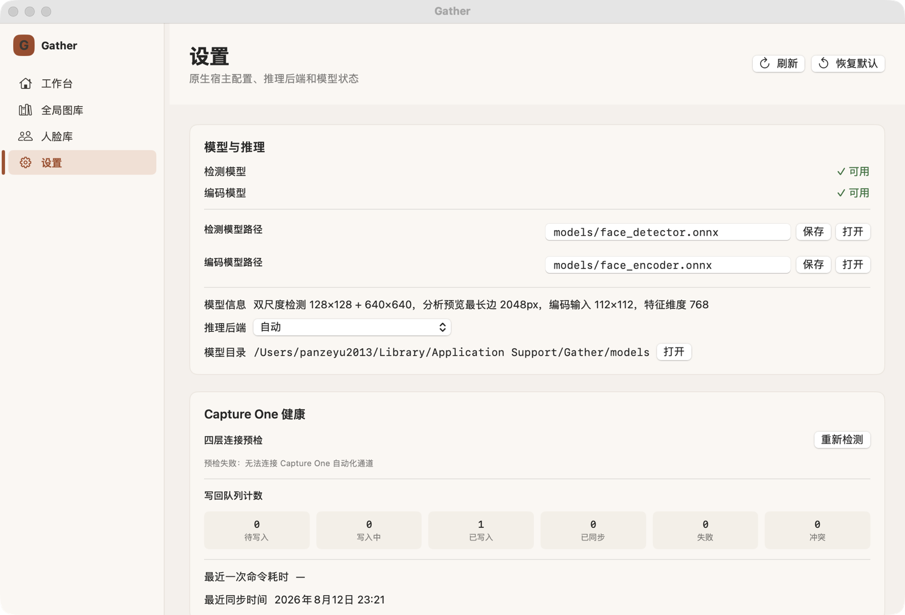 | 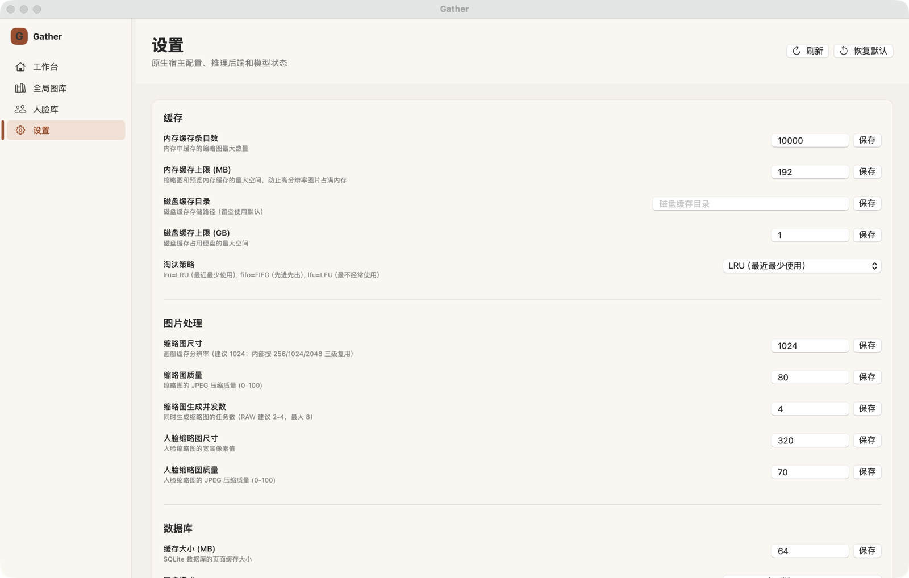 |

### 3.2 问题清单

| # | 问题 | 证据 |
| --- | --- | --- |
| S1 | **不是 `Settings` scene，不是 `Form`。** 一个 `VStack` + `ScrollView` + 5 张自绘卡片；⌘, 只是切换主窗口内容（`RootView.swift:273-275` → `navigation.selectWeb(.settings)`）。用户因此**丢失当前浏览上下文**，设置也不能与图库并排常开。 | `SettingsView.swift:1030-1046`；`GatherApp.swift:25-62`（无 `Settings` scene）；`GatherAppDelegate.swift:178`（手搓 ⌘,） |
| S2 | **`.roundedBorder` 是 Aqua 时代的贝塞尔文本框**，在暖色扁平卡片里既非"系统原生"也非"自绘体系"，两边都不靠。没有焦点环策略、没有校验态、没有 `Form` 的标签列关联。 | `SettingsView.swift:1210 / 1485 / 1497`；另见 `SliderInputView.swift:42 / 99`、`ExportView.swift:628 / 641 / 661 / 675 / 699`、`LibraryView.swift:126 / 148 / 152 / 156 / 239`、`GalleryView.swift:287`、`PersonsView.swift:113 / 468`、`FaceKeywordingView.swift:1565 / 1568`（共 23 处） |
| S3 | **900pt 空白走廊 + 每个字段一个保存按钮 + 四个魔法宽度**（见 P0-3）。 | `SettingsView.swift:1466-1531` |
| S4 | **排版层级扁平**：卡片标题 / 分组标题 / 子分区标题全都是 `.title3.weight(.semibold)`，共 7 处；正文行 12pt、说明 10pt。 | `SettingsView.swift:1108 / 1279 / 1368 / 1392 / 1400 / 1451` |
| S5 | **✓/✗ 文本字形 + 颜色唯一信号，无无障碍值**（见 P0-4）。 | `SettingsView.swift:1346-1357` |
| S6 | **6 格等权队列计数**：`LazyVGrid` 6 列，`失败`/`冲突` 与 `已同步` 同样式，需要行动的那个数字反而最不显眼；同一个 `GatherStatCard` 还额外引入第三种 `.compact` 样式。 | `SettingsView.swift:1308-1318 / 1360-1362`；`GatherCommonViews.swift:56-72` |
| S7 | **滑杆行与共享滑杆控件不一致**：设置页是"标签在上 + 通栏滑杆"（`:1409-1431`），人脸页用的是 110pt 标签列的 `SliderInputView`（`SliderInputView.swift:30-53`）。同一种数据类型两套行布局，两页之间毫无对齐关系。 | `SettingsView.swift:1409-1431` vs `FaceKeywordingView.swift:1142 / 1146` |
| S8 | **「模型信息」把一句 60 字的长句塞进 `LabeledContent` 的值列**，把标签顶到段落顶部。 | `SettingsView.swift:1135-1148` |
| S9 | **模型目录路径不可选中、不可复制、不能在访达中显示** —— 而文案恰恰要求用户把模型文件放进这个目录。 | `SettingsView.swift:1162-1172 / 1229-1231` |
| S10 | **「恢复默认」与「刷新」外观完全相同**，但前者会清空全部设置。 | `SettingsView.swift:1093-1098` |
| S11 | 组标题下的**分隔线用 `Divider()` 叠加 `opacity`**，在深色模式下几乎消失（1.17:1）。 | `SettingsView.swift:1457-1459` |
| S12 | 提示条 `NativeBanner` 常驻不消失、插入时顶开内容。 | `SettingsView.swift:1033-1034`；`RootView.swift:607-633` |
| S13 | 语言提示硬编码英文：`notice = value == "en" ? "Language saved" : …` | `SettingsView.swift:189` |

### 3.3 建议的设置页形态

~~~swift
// GatherApp.swift —— 真正的 Settings scene（macOS 11+）
var body: some Scene {
    WindowGroup { RootView(...) }
    Settings { GatherSettingsView(router: router) }   // ⌘, 自动可用
}

// GatherSettingsView —— 分组 Form（macOS 13+ 的 grouped 样式）
Form {
    Section("模型与推理") {
        LabeledContent("检测模型路径") {
            TextField("models/face_detector.onnx", text: $detectorPath)
                .onSubmit(save)
                .textSelection(.enabled)
        }
        LabeledContent("推理后端") { Picker("", selection: $backend) { … }.labelsHidden() }
        LabeledContent("模型目录") {
            Text(modelDir).textSelection(.enabled)
            Button("在访达中显示") { NSWorkspace.shared.activateFileViewerSelecting([url]) }
        }
    }
    Section("缓存") {
        LabeledContent("内存缓存条目数") { TextField("", value: $cacheCount, format: .number).onSubmit(save) }
        LabeledContent("淘汰策略") { Picker("", selection: $policy) { … }.labelsHidden() }
    }
    // …
}
.formStyle(.grouped)
.frame(minWidth: 520, minHeight: 420)
~~~

这样一次性解决 S1–S12：标签列自动对齐、右边缘自动对齐、行内边距与选中高亮由系统给、编辑即生效（`onSubmit`）、无障碍关联自动建立、macOS 26 上自动获得玻璃质感行背景；`Settings` scene 还免费带来正确的窗口行为（最小化/缩放按钮变灰、窗口标题为「Gather 设置」、恢复上次打开的 pane）。

---

## 4. P1：分类要点

以下是各领域里最影响"像不像 Mac 软件"的条目。

### 4.1 窗口与导航

| 问题 | 证据 | 修法 |
| --- | --- | --- |
| 全 app 无 `.toolbar`；刷新/新建/返回/设置/页签/搜索/筛选/密度/分页全在内容区 | 全库 `grep '\.toolbar'` = 0 | `NavigationSplitView` + `.toolbar { ToolbarItemGroup(placement: .primaryAction) }` |
| 手搓侧栏：`Button` + `primarySoft` 圆角块 + 左侧 4pt 竖条 + 不透明 `gatherSurface` 背景 | `RootView.swift:463-595` | `List(selection:).listStyle(.sidebar)` 放进 `NavigationSplitView`；macOS 26 自动获得玻璃侧栏 |
| 手搓侧栏拖拽调宽 + `NSCursor.push()/pop()` | `RootView.swift:359-384` | `.navigationSplitViewColumnWidth(min:ideal:max:)`（macOS 13+）；自定义指针用 `.pointerStyle(.frameResize(position: .trailing))`（macOS 15+） |
| 手搓页签栏（7 个 Button + 下划线） | `SessionTabBar.swift:46-83` | 工具栏里的 `.pickerStyle(.segmented)` 或 `TabView`；补 ⌘1–⌘6 |
| 内容区返回按钮，命中高度仅行高（≈17–18pt，低于 24pt 下限） | `GalleryView.swift:180-184`、`CullingView.swift:1610` 等 6 处 | 移入 `.toolbar(placement: .navigation)`；`⌘[` |
| 窗口最小尺寸 1100×720，超出 1440pt 屏的一半分屏 | `RootView.swift:246`、`GatherApp.swift:48 / 51` | 降到约 820×560，布局用 `ViewThatFits` 自适应 |
| 页面用 `.opacity(0)` 常驻而非按需构建，导致 select mode / 筛选 / 滚动位置跨导航泄漏，并让弹窗需要 `.disabled(false)` 兜底 | `RootView.swift:166-237`；`GatherCommonViews.swift:273-278`；`GalleryView.swift:139-141` | 用 `NavigationStack` / `NavigationSplitView` 真正条件构建 |
| 无 `Settings` scene | `GatherApp.swift:25-62` | 见 §3.3 |

### 4.2 主题与颜色

| 问题 | 证据 | 修法 |
| --- | --- | --- |
| 硬编码 hex 调色板，无高对比度变体，无 Material | `GatherTheme.swift:9-57` | 表面/文字/分隔线改用语义色与 `Material`，品牌色只留作 accent |
| 卡片对比 1.06:1、边框 1.32:1（深色 1.16 / 1.17） | `GatherTheme.swift:14-22 / 75-85` | `Color(nsColor: .controlBackgroundColor)` / `.windowBackgroundColor` / `.separatorColor`，或 `.background(.regularMaterial, in: RoundedRectangle(cornerRadius: 10))` |
| `.tint(GatherTheme.primary)` 覆盖用户系统强调色 | `RootView.swift:248` | 移除根 tint，或只在主按钮上 tint；侧栏图标遵循 `controlAccentColor` |
| 同一个"选中"角色有两个来源：`Color.accentColor`（不随 `.tint` 改变）与 `GatherTheme.primary` | `DashboardView.swift:441-448 / 518-526` vs `RootView.swift:248` | 统一为一个 token，或交给 `List(selection:)` 渲染 |
| 8 个 C1 色标用 Material 调色板 hex，不随深色/对比度/色盲滤镜变化 | `CullingView.swift:2497-2508`；`LibraryView.swift:765-770`（重复的第二份表） | 改为 `Color(nsColor: .systemRed / .systemOrange / …)`，并把映射收敛到一处 |
| 语义色在三处各自微调，`dynamicText` + `NSColor(hexString:)` 被重复实现三次 | `GatherBadge.swift:15-24`、`C1StatusCapsule.swift:199-201`、`LibraryView.swift:761-770` | 一个"在暖色表面上可读的语义色"helper |
| 徽标对中文施加 `.textCase(.uppercase)` + `.kerning(0.5)` | `GatherBadge.swift:48-59` | 中文去掉 uppercase/kerning；字号提到 `.caption` / `.subheadline` |

### 4.3 表单与输入控件

| 问题 | 证据 | 修法 |
| --- | --- | --- |
| 搜索框是普通 `TextField`，没有放大镜、清除按钮、Esc 清空、⌘F | `GalleryView.swift:286-291`、`LibraryView.swift:125-128`、`PersonsView.swift:112-116` | `.searchable(text:placement:)`（macOS 12+） |
| `Picker` 的可访问名等于当前值（`Picker("中图", …)`），VoiceOver 播报"网格尺寸 = 中图" | `GalleryView.swift:300-306`、`LibraryView.swift:104-111` | 给控件真标签 + `.accessibilityValue`，或放进 `Form` 的 `LabeledContent` |
| 三个高级筛选字段完全没有标签，只有 placeholder，输入后即失去语义 | `LibraryView.swift:147-158` | `LabeledContent` |
| 导出选项：标签列 60pt 右对齐 + 无标签的 180pt 字段 + 通栏 placeholder 字段混排，魔法宽度 60 / 180 / 220 / 140 / 70 / 42 | `ExportView.swift:584-715` | `Form` + `LabeledContent` + `.formStyle(.grouped)` |
| 依赖型控件（水印）没有缩进/分区/动画，开关一开整卡跳动 | `ExportView.swift:656-694` | `DisclosureGroup` 或 `Form` `Section` + `.animation(.default, value:)` |
| `NSOpenPanel.runModal()` 全局模态、阻塞主线程 | `ExportView.swift:141-145 / 706` | `beginSheetModal(for:)` 或 `.fileImporter`（macOS 11+） |
| 新建工作区 sheet 是无标签的裸 `VStack`，路径用**禁用**的 `TextField` 充当只读展示 | `DashboardView.swift:722-777 / 805-807` | `Form` + `LabeledContent`；只读路径用可选中 `Text` |
| 设置页每字段一个保存按钮，无脏标记，离开即丢 | `SettingsView.swift:1487-1500`；另见 [ux-review.md](ux-review.md) P1 #9 | `Form` + `onSubmit` 自动保存 |

### 4.4 自绘控件替代

| 应有 | 实际 | 证据 |
| --- | --- | --- |
| `ProgressView(value:total:)`（macOS 13+ 亦可 `Gauge` + `.accessoryLinearCapacity`） | `GeometryReader` + 两个 `RoundedRectangle`；28pt 高、140pt 宽的定制条 | `GatherCommonViews.swift:79-145`；`DashboardView.swift:670-680`；`GalleryView.swift:244-256`；`ExportView.swift:372-382` |
| `DisclosureGroup`（macOS 11+） | 整行 plain `Button` + 10pt 灰字提示 | `DashboardView.swift:317-339` |
| `ContentUnavailableView`（macOS 14+） | 自绘虚线大块 + 60×60 图标底 + `.system(size: 28)` | `DashboardView.swift:345-414`、`LibraryView.swift:599-615`、`SessionControlView.swift:241-248` |
| `Picker(.segmented)` | 手绘 pill + 手绘选中底（相似度/人脸/重复三处） | `SimilarityView.swift:293-303`、`FaceKeywordingView.swift:1236-1268`、`DuplicatesView.swift:529-539` |
| `List(selection:)` / `Table` | 手搓多选 + `NSEvent` 轮询修饰键 | `CullingView.swift:2665-2764`、`GalleryView.swift:436-443` |
| `.commands` / `CommandGroup` | 零尺寸全透明按钮承载 ⌘− / ⌘0 / ⌘= / ⌘+ | `CullingView.swift:2857-2873` |
| `.onKeyPress` / `.keyboardShortcut` | 全局 `NSEvent.addLocalMonitorForEvents` | `GalleryView.swift:792-809`、`CullingView.swift:2437-2489 / 3088-3114` |

### 4.5 排版

- 10pt 承载内容语义（计数、文件名、状态、错误）—— 见 §R4 清单。**主计数用 `.callout`(12) 或 `.body`(13)，说明/次要信息才配 `.footnote`(10)。**
- `GatherStatCard` 的数值用 `.system(size: 24, weight: .bold)`（`GatherCommonViews.swift:45`），绕过文本样式，不随系统设置缩放。改用 `.title2` / `.title`。
- 图标尺寸硬编码 `.system(size: 28)` / `(40)` / `(18)`（`DashboardView.swift:348 / 372 / 445`、`LibraryView.swift:602`、`PersonsView.swift:136 / 209`）。改用 `.imageScale(.large)` + 文本样式。
- 圆角阶梯形同虚设：主题定义 6/8/10（`GatherTheme.swift:42-46`），实际使用 6/8/10/12/14/20，`GatherTheme.Radius` 在这些文件里被引用 **0 次**。

### 4.6 交互与可访问性

| 问题 | 证据 |
| --- | --- |
| **挑片页 36 处 `.focusable(false)` 关闭全键盘访问** —— 在 macOS 上 Tab 遍历是系统级无障碍能力，不该被 app 关闭 | `CullingView.swift:3173` 定义，36 处调用（`:1610`–`:2756`） |
| 重复页 0 个 `.accessibility*`、0 个 `.help` | `DuplicatesView.swift`（全文） |
| 全局图库 0 个 `.accessibility*`；评分用 ★★★★☆ 字形文本，VoiceOver 读出"黑色星 黑色星 白色星…" | `LibraryView.swift`（全文），`:761-770` |
| 人物行 `.accessibilityLabel(person.name)` **覆盖**子内容，VoiceOver 丢掉「N 张照片 · M 个工作区」 | `PersonsView.swift:166` vs `:235` |
| `.help()` 覆盖率极低：GalleryView 1 处、Dashboard 3 处、Library 4 处、Export **0** 处 | 各处 |
| 图标按钮命中区 <24pt：`.fixedSize()` 把菜单压成 ≈16pt 字形 | `DashboardView.swift:503-509` |
| `.help("")` 空 tooltip、禁用控件上的 `.help` 永不显示、tooltip 与控件语义矛盾 | `CullingView.swift:2002`；`FaceKeywordingView.swift:1812-1830` |
| 选中态用 `.opacity(0.72 / 0.78)` 整体压暗（含 10pt 文字），对比度进一步跌破 AA | `CullingView.swift:2759`、`DuplicatesView.swift:721` |
| 「保留」按钮的标签是**当前状态**，动作却是**相反操作**（点了"保留"反而丢弃） | `DuplicatesView.swift:700-702` |
| 两个 `confirmationDialog` 挂在同一个视图节点上 | `DuplicatesView.swift:443-468` |
| 无 `defaultFocus` 的 sheet，用户必须先用鼠标点进输入框 | `PersonsView.swift:464-486` |

### 4.7 性能感知（影响"手感"）

| 问题 | 证据 | 影响 |
| --- | --- | --- |
| `GatherLocalization.l()` **每次调用都新建 `Bundle`**（文件系统查询 + 锁） | `GatherLocalization.swift:262-268` | 200 格网格 × 每格 2–3 条 = 每帧数百次 Bundle 构造 → 滚动掉帧 |
| justified 布局在 `body` 里同步全量重算，且缓存 key 含宽度（实时缩放时永不命中）；还在 `body` 里写 `State` | `GalleryView.swift:390-425` | 拖窗口/切侧栏逐帧卡顿；"modifying state during view update" 反模式 |
| 主线程同步 IPC（见 P0-16） | 多处 | 周期性无解释卡顿 |
| 图库分页按钮切换页后不重置滚动位置 | `LibraryView.swift:628-644` | 每次翻页落在新页中部 |

---

## 5. P2：一致性打磨（摘要）

1. `gatherCard()` 在 Dashboard / Library / Gallery / Duplicates / Export / Culling 里被**手工重写 8 次**，圆角 8/10/12、内边距 12/14/18、边框透明度 0.6/0.8 各不相同 → 收敛为一个 `.cardStyle()`。
2. `Rectangle().fill(...).frame(height: 1)` 当分隔线用（`DashboardView.swift:235-239`、`WritebackReportCard.swift:68-70`）→ 用 `Divider()` / `.separatorColor`，还能正确处理 @1x 缩放。
3. 同一个"统计数字"有 3 种字号：24pt bold / `callout.monospaced()` / `callout.weight(.semibold).monospaced()`。
4. 手绘虚线边框（`DashboardView.swift:358-364 / 387-393 / 403-412`）→ 虚线在 macOS 上是拖放目标的语义，不是装饰。
5. 空态图标尺寸在 `LibraryView.swift:602` 和 `GatherEmptyState(iconSize: 40)` 里各写一遍，且 Library 不用共享组件。
6. 文件大小格式化两套：`ExportView` 用 `ByteCountFormatter`，`DuplicatesView.swift:697` 手工除 1024²（2 GB 会显示成 `2048.0 MB`）。
7. `LibraryView.swift:685` 输出原始英文 token：中文界面里出现 `Red · 工作区A`；同文件 `:748-758` 已有本地化色名却只用在筛选器里；`无色标` 是全文唯一没走 `l()` 的字面量。
8. 分页、密度、筛选等 15+ 个控件缺 `.help()`。
9. 无 ⌘F / ⌘R / ⌘1–⌘6 / 空格快速查看 / ⌘+−0 / Esc 取消选择。Edit 菜单的 ⌘A 绑定 `NSText.selectAll:`（`GatherAppDelegate.swift:230`），在网格里按 ⌘A 无任何反应。
10. Lightbox 用固定最小尺寸的 sheet 承载沉浸式查看器；`MagnificationGesture` 在 macOS 14 已废弃（两处：`GalleryView.swift:652`、`CullingView.swift:2987`），应换 `MagnifyGesture`。
11. `LibraryView` 筛选面板 12 个控件的魔法宽度（220 / 150 / 150 / 150 / 150 / 150 / 180 / 150 / 150 / 150）无栅格。
12. 错误展示不一致：Dashboard / Library / Gallery 用裸红字，Settings / Culling 等用 `NativeBanner`，另有 Toast 系统。
13. 导出确认弹窗用**破坏性**按钮角色（红色）确认一个不会覆盖任何文件的普通导出（`ExportView.swift:455-471` + `GatherCommonViews.swift:237` 默认 `confirmRole = .destructive`）—— 会稀释全 app 的破坏性信号。
14. 导出命名预览在中文界面打印 `IMG_1234.扩展名`（`ExportView.swift:82` 用句子式伪 key，zh 表为空时回落到 key 本身）。

---

## 6. 对齐最新 macOS（Liquid Glass）的落地路线

HIG *Materials*（2025-09-09 更新）与 SwiftUI 文档给出的关键事实：

- **Liquid Glass 是"功能层"，内容层不应用它。** 原文：*"Liquid Glass forms a distinct functional layer for controls and navigation elements — like tab bars and sidebars — that floats above the content layer"*、*"Don't use Liquid Glass in the content layer."*
- 系统组件**自动**获得它；自定义控件应**克制**使用。
- 相关 API 的可用性：`Glass` / `.glassEffect(_:in:)` / `GlassEffectContainer` / `.buttonStyle(.glass)` / `.buttonStyle(.glassProminent)` / `.backgroundExtensionEffect()` / `.scrollEdgeEffectStyle(_:for:)` / `.containerShape(_:)` **均为 macOS 26.0+**。本 app 部署目标是 macOS 14，因此**必须用 `if #available(macOS 26.0, *)` 包裹**。

推荐的三步走：

### 第一步（不需要 macOS 26）：把外壳换成系统容器

这是**收益最大、风险最低**的一步，且完全向后兼容 macOS 14：

~~~swift
NavigationSplitView {
    List(selection: $navigation.destination) {
        Label("工作台", systemImage: "house").tag(RootNavigation.Destination.dashboard)
        // …
    }
    .listStyle(.sidebar)
    .navigationSplitViewColumnWidth(min: 180, ideal: 200, max: 320)
} detail: {
    pageContent
        .navigationTitle(pageTitle)            // macOS 11+
        .navigationSubtitle(windowSubtitle)    // macOS 11+
        .toolbar {
            ToolbarItemGroup(placement: .primaryAction) {
                Button("刷新", systemImage: "arrow.clockwise") { … }
                Button("新建工作区", systemImage: "plus") { … }
            }
            ToolbarItem(placement: .principal) {
                Picker("", selection: $section) { … }   // 取代 SessionTabBar
                    .pickerStyle(.segmented).labelsHidden()
            }
        }
        .searchable(text: $query, placement: .toolbar)     // macOS 12+
}
~~~

这一步一次性拿掉：手搓侧栏、手搓页签、内容区返回按钮、13 处大标题、每页的假标题栏、`.opacity(0)` 常驻页。副作用是**所有页面自动获得 macOS 26 的玻璃标题栏与侧栏**，不需要写一行 Liquid Glass 代码。

### 第二步：表面与文字改用语义色 / Material

~~~swift
// 表面
.background(Color(nsColor: .controlBackgroundColor))                   // macOS 10.14+
// 或需要浮层质感时
.background(.regularMaterial, in: RoundedRectangle(cornerRadius: 10))  // macOS 12+
// 分隔线
Divider()  // 或 Color(nsColor: .separatorColor)
// 选中
Color(nsColor: .selectedContentBackgroundColor) / .selectedContentTextColor
~~~

保留暖橙品牌色作为 `.tint` / accent，而不是全部表面与文字的颜色来源。

### 第三步（macOS 26+ 条件启用）：让功能性 chrome 获得玻璃质感

~~~swift
if #available(macOS 26.0, *) {
    // 浮动工具栏按钮
    .buttonStyle(.glass)                    // 或 .glassProminent 用于主操作
    // 工具栏分组
    ToolbarSpacer(.flexible)
    // 内容延伸进工具栏下
    .backgroundExtensionEffect()
    // 滚动边缘效果
    .scrollEdgeEffectStyle(.soft, for: .top)
}
~~~

**不建议**把整个内容区包进玻璃 —— HIG 明确禁止在内容层使用它。

---

## 7. 建议的改造顺序

| 批次 | 内容 | 影响面 | 为什么先做 |
| --- | --- | --- | --- |
| **B0** | 修 16 条 P0（标签重复、卡片宽度、裁切、隐藏滚动条、对比度、空态、错误态、主线程阻塞） | 小 | 都是"少改代码、多修体验"，且每一条都能单独验证 |
| **B1** | `NavigationSplitView` + 真 `.toolbar` / `.navigationTitle` / `.searchable` + `Settings` scene，删除 13 处大标题、内容区返回按钮、手搓页签 | 大（外壳 + 全部页面头部） | 一次改动消灭根因 R2，并自动获得 macOS 26 的窗口 chrome |
| **B2** | 主题换成语义色 + Material + 高对比度支持；修 warning / selection 对比度 | 中（`GatherTheme` + 全页表面） | 消灭 R1，同时解决 P0-5 / P0-12 |
| **B3** | 自绘控件替换：`ProgressView`、`DisclosureGroup`、`Picker(.segmented)`、`Form`+`LabeledContent`、`List(selection:)` | 大 | 消灭 R3；设置页/导出页在这一批重写 |
| **B4** | 排版与间距 token 化：10pt 内容提升、去 kerning/uppercase、圆角与间距阶梯统一 | 中 | 消灭 R4；纯机械替换，可用 grep 收口 |
| **B5** | 交互与可访问性：删除 36 处 `nonFocusable()`、补 `.help()` / `.accessibility*`、命中区 ≥24pt、补 ⌘F / ⌘R / ⌘1–⌘6 / ⌘[ | 中 | 一次性把"能用鼠标但键盘/读屏不可用"补上 |
| **B6** | 性能：`GatherLocalization` 缓存 Bundle、justified 布局移出 body、IPC 异步化 | 中 | 手感提升最直接 |
| **B7** | 条件启用 macOS 26 Liquid Glass 按钮/工具栏样式 | 小 | 在 B1 之后是收尾工作 |

---

## 8. 哪些**不要**改

这一节同样重要 —— 以下是评审中确认的高质量设计，改造时不要顺手破坏：

1. **破坏性动作的确认门控。** `gatherDestructiveConfirm`（`GatherCommonViews.swift:233-283`）保证 `confirmed: true` 只能从确认分支到达，取消会写可见文案而不是静默 return；确认文案陈述真实影响面（数量/路径/不可恢复）。这比多数原生 app 都规范。
2. **写回预览的"影响面清单"。** 人脸页的 before→after、新建/更新 XMP、共享张数、外部冲突、示例路径（`FaceKeywordingView.swift:1604-1631`）是行业级设计，Lightroom / Immich / C1 都不给逐文件 diff。
3. **缩略图管线。** 后台解码 + 4 路信号量限流 + 过期结果丢弃 + 512MB cost 上限 LRU（`PhotoThumbnailView.swift:71-168`），以及图库的 keyset 游标 + 相邻预取。
4. **Reduce Motion 在共享组件里被尊重**（`GatherCommonViews.swift:90 / 140`、`RootView.swift:133 / 181 / 261`、`GatherToast.swift:116-124`）。新增动效请延续这个习惯。
5. **事件风暴控制。** 进度帧在触达 `Observable` 状态前被节流/去抖；隐藏页显式停止轮询（`GalleryView.swift:85-97`、`RootView.swift:316-355`）。
6. **本地化与错误的漏斗。** 原始英文诊断被刻意挡在用户文案之外（对中日韩字符例外放行、英文 NSError 进 tooltip），`ErrorLocalizationCoverageTests` 守着它。
7. **Dashboard 工作区卡片的无障碍契约**（`DashboardView.swift:488-493`）：`.contentShape` + 上下文 `accessibilityLabel` + `.isSelected` + 说明选中状态的 `accessibilityValue` —— 这正是 `LibraryView`（0 处）和图库单元格（只有 trait）缺失的模板。
8. **人物详情页的 `Form` + `.formStyle(.grouped)`**（`PersonsView.swift:303-354`）—— 全 app 唯一一处正确用法，改外壳时把它作为其余表单的目标形态，而不是把它改成卡片。

---

## 附录 A · 证据截图

截图由真机运行 `release/Gather.app` 捕获（macOS 27.0，窗口 1380×880），深色模式通过 `NSApp.appearance` 显式指定。

| 浅色 | 深色 |
| --- | --- |
| 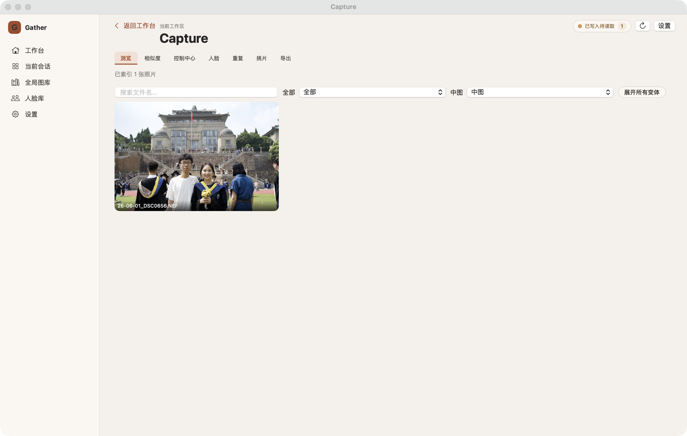 | |
| 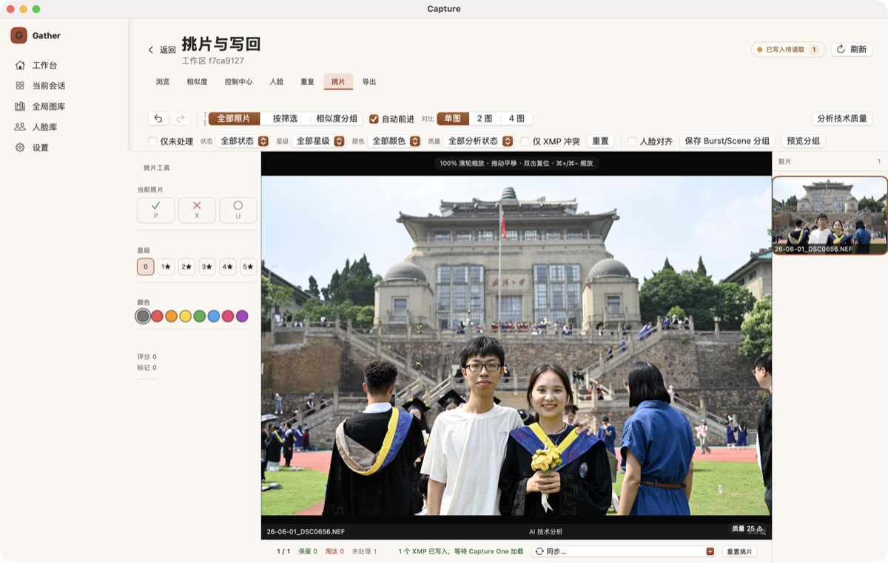 | 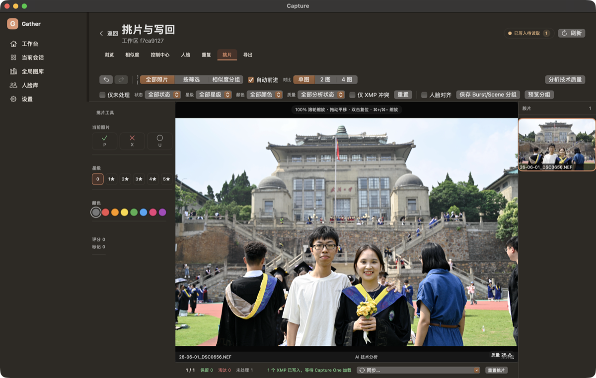 |
|  | 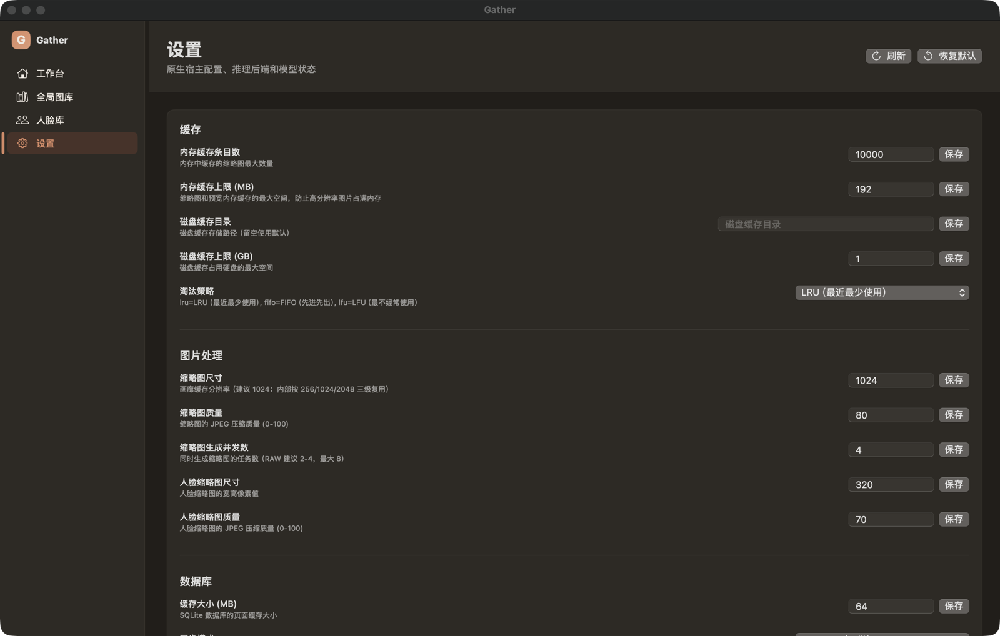 |
|  | |
| 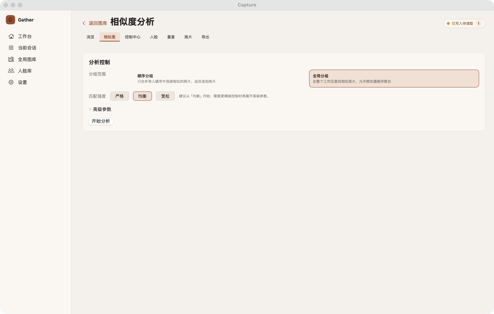 | |
| 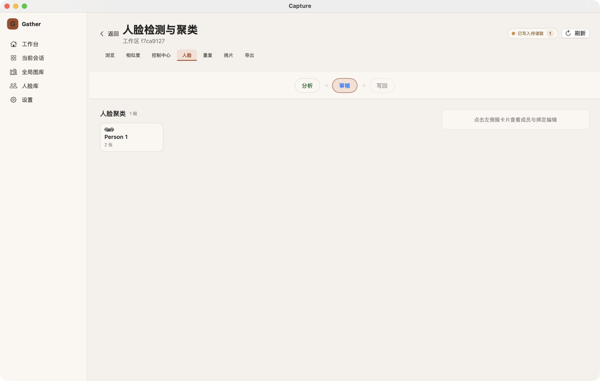 | |
| 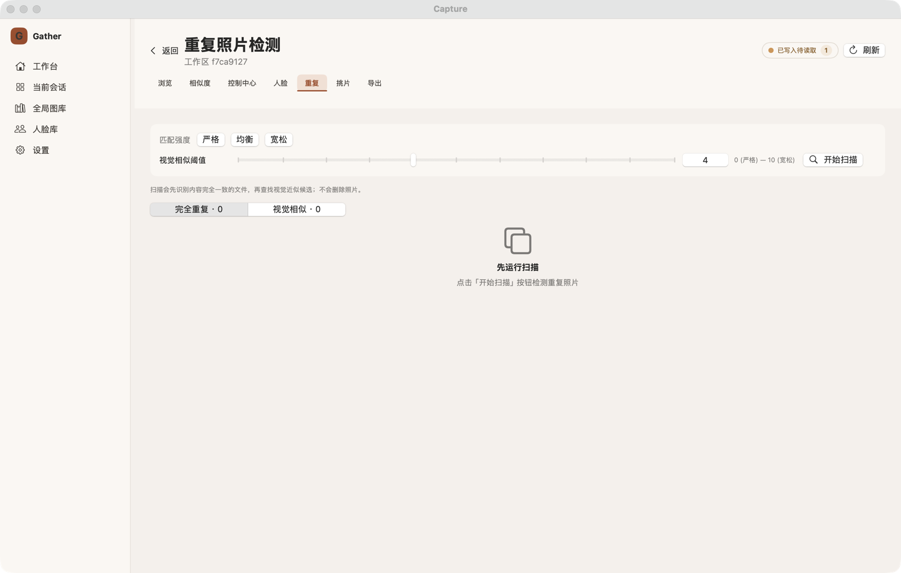 | |
| 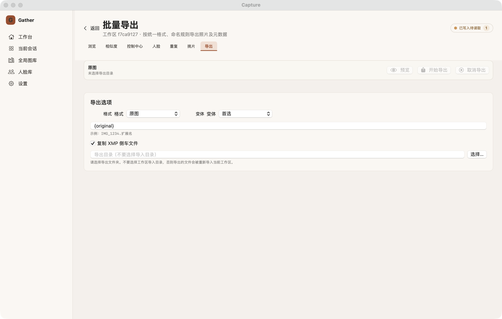 | |
| 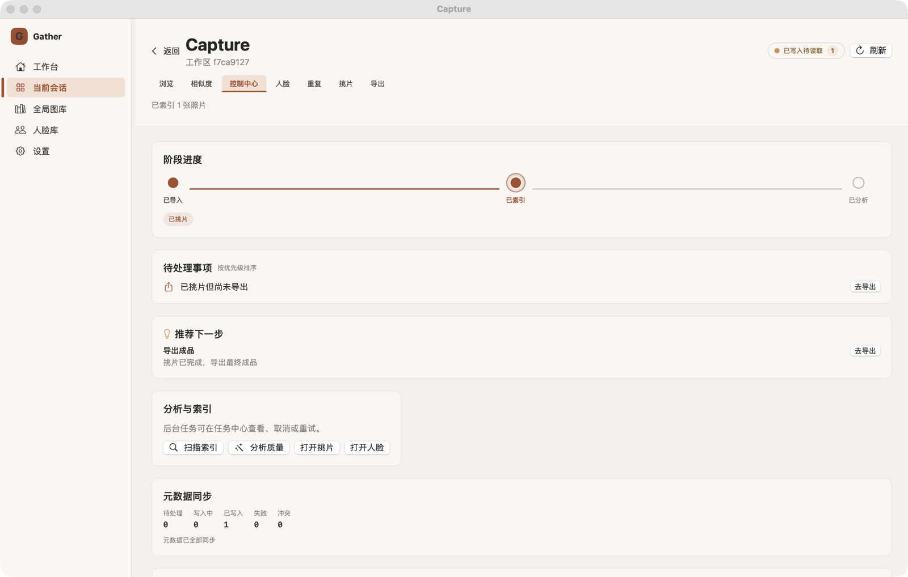 | |
| 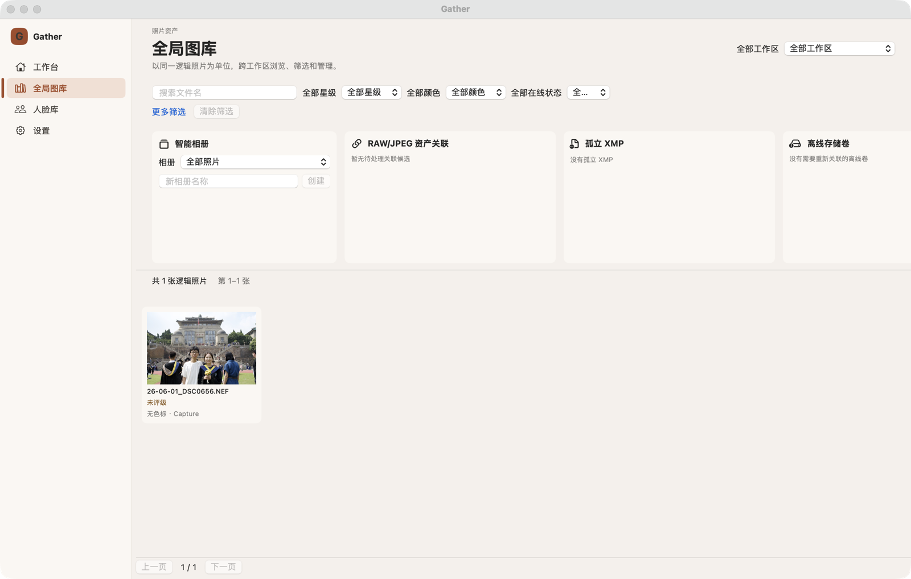 | 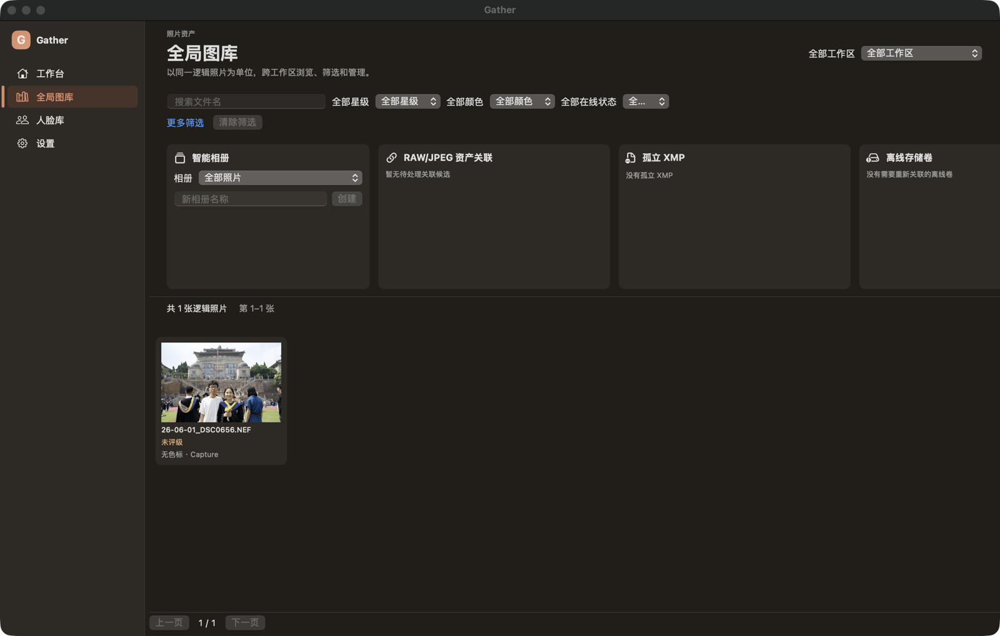 |
| 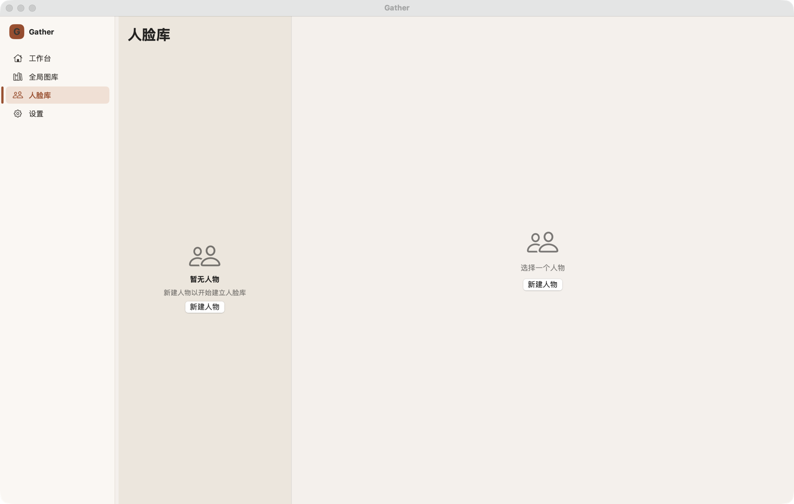 | |

截图可直接复核的可见问题：图库第 4 张支持卡被切掉（10）、导出页「格式 格式 / 变体 变体」（08）、设置页「语言」卡片偏窄与 900pt 空走廊（03 / 04）、控制中心两张卡片偏窄（09）、挑片页工具栏第二行右端被截断（02）、会话 UUID 作为副标题（02 / 08 / 09）、以及 6 格等权队列计数（03 / 13）。

## 附录 B · 引用与 API 可用性

> 另见两份配套文件：[分区源码审查明细](visual-design-review-detail-native-views.md)（设置 / 人脸 / 控制中心 / 人物的逐条明细）与 [macOS 设计语言参考资料](visual-design-review-macos-design-reference.md)（逐条附 SDK 可用性注解与 Apple 官方链接）。

**Human Interface Guidelines**

- [Typography](https://developer.apple.com/design/human-interface-guidelines/typography) —— macOS 默认 13pt / 最小 10pt；文本样式字号阶梯（LargeTitle 26 … Footnote 10）
- [Color](https://developer.apple.com/design/human-interface-guidelines/color) —— *"Avoid hard-coding system color values in your app"*、*"Avoid relying solely on color …"*、*"Make sure all your app's colors work well in light, dark, and increased contrast contexts"*
- [Materials](https://developer.apple.com/design/human-interface-guidelines/materials)（2025-09-09 更新 Liquid Glass 指引）—— *"Don't use Liquid Glass in the content layer."*、*"Use Liquid Glass effects sparingly."*
- [Sidebars](https://developer.apple.com/design/human-interface-guidelines/sidebars) —— 侧栏图标应遵循 `controlAccentColor`；侧栏应为玻璃层
- [Toolbars](https://developer.apple.com/design/human-interface-guidelines/toolbars) —— *"In a macOS app, the toolbar resides in the frame at the top of a window"*；溢出交给系统；*"Use the standard Back and Close buttons"*
- [Settings](https://developer.apple.com/design/human-interface-guidelines/settings) —— macOS 自定义设置窗口应有工具栏分 pane、最小化/缩放按钮变灰、⌘, 打开、标题反映当前 pane

**SwiftUI API 与可用性**

| API | 最低版本 | 用途 |
| --- | --- | --- |
| `NavigationSplitView` / `.navigationSplitViewColumnWidth` | macOS 13+ | 侧栏 + 内容 |
| `.navigationTitle` / `.navigationSubtitle` | macOS 11+ | 窗口标题与副标题 |
| `Settings` scene / `SettingsLink` | macOS 11+ / 14+ | ⌘, 设置窗口 |
| `.searchable(text:placement:)` | macOS 12+ | 系统搜索框 |
| `Form` / `.formStyle(.grouped)` | macOS 13+ | 偏好设置与表单 |
| `ContentUnavailableView` | macOS 14+ | 空态 / 错误态 |
| `.inspector(isPresented:)` | macOS 14+ | 次要面板（筛选、冲突、导出选项） |
| `Table` | macOS 12+ | 失败项 / 预览文件列表 |
| `Gauge` + `.gaugeStyle(.accessoryLinearCapacity)` | macOS 13+ | 带标签的容量条 |
| `.regularMaterial` / `.ultraThinMaterial` | macOS 12+ | 浮层与照片上的文字底板 |
| `MagnifyGesture` | macOS 14+ | 替代已废弃的 `MagnificationGesture` |
| `.onKeyPress` | macOS 14+ | 替代 `NSEvent` 键盘监视器 |
| `.defaultFocus(_:_:)` | macOS 14+ | sheet 初始焦点 |
| `.pointerStyle` | macOS 15+ | 替代 `NSCursor.push()/pop()` |
| `Glass` / `.glassEffect(_:in:)` / `GlassEffectContainer` / `.buttonStyle(.glass)` / `.backgroundExtensionEffect()` / `.scrollEdgeEffectStyle(_:for:)` | **macOS 26+** | Liquid Glass（需 `if #available`） |

---

*本评审由 3 份只读分区审查（浏览面 / 挑片-导出-重复 / 设置-人脸-控制中心-人物）与 1 份 HIG 资料检索汇总，并由编排者在 macOS 27 上实跑 GUI 逐页截图复核。所有验收性结论均附 `文件:行号` 或截图。*
