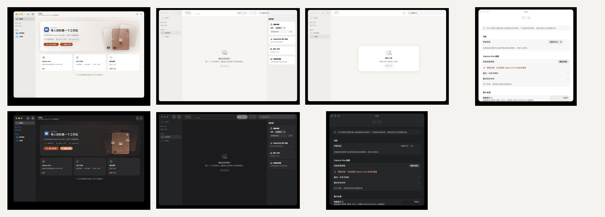

# 外观第一里程碑执行记录（2026-10-24）

> 对应方案：[外观与交互的宏观架构评审](appearance-interaction-architecture-2026-10-24.md)
> 范围：只做 **DesignSystem 基础 + 四个全局页**；不改 7 个会话页、不改导航语义、不改命令层。
> 后续 Phase 2-3 已完成、Phase 4 部分完成：[Phase 2-4 执行记录](appearance-m2-m4-execution.md)。

## 1. 对原方案的修正（执行前反思）

| 原方案 | 最终决定 | 原因 |
| --- | --- | --- |
| 建完整 `GatherChrome` / `GatherSessionPage` | 本轮只做全局页 `gatherPage`，会话 scaffold 留到 Phase 2 | 会话页有 inspector/toolbar/页签/生命周期耦合，一次改 7 页风险高 |
| 页面 scaffold 接管 toolbar/inspector | 本轮 scaffold 只接管 frame/背景/标题/副标题 | SwiftUI toolbar/inspector 的泛型槽位会打架；先收确定的部分 |
| 拆 `DesignSystem` 成独立 target | 只建目录，不拆 target | 避免 public API 扩散与 30k 行 UI 的编译成本 |
| 全仓修间距/字号 | 本轮只加 token + ratchet，不做批量替换 | 6/10/14 的收敛会动布局，必须逐页截图 |
| 把 SessionTab 四套枚举一次合并 | 本轮不动，只写 Interaction 契约 | 路由改动需要行为矩阵，不能和页面迁移混在一起 |
| 基于系统 `ContentUnavailableView` 另造空态 | `GatherEmptyState` 改为系统视图薄包装 | 保留原生外观，减少自定义视觉 |

## 2. 完成的改动

### DesignSystem

- 新建 `Sources/GatherUI/DesignSystem/`：
  - `Tokens/`：`GatherTheme`、`GatherStyle`、`GatherGlass`、`GatherChromeMetrics`
  - `Components/`：`GatherCommonViews`、`GatherBadge`、`NativeBanner`、`GatherToast`、`PhotoOverlayChip`、`GatherSection`、`GatherEmptyState`
  - `Patterns/`：`GatherPage`（`gatherPage` modifier + 容器）
  - `Modifiers/`：`gatherSurface`、`gatherText`
- 主题/共享叶子从 `Support/` 迁出；`Support/` 只留基础设施。
- `GatherChromeMetrics` 成为窗口/侧栏/检查器尺寸单点；`RootShellMetrics` 与三处 inspector 宽度改为引用它。
- `GatherEmptyState` 从 0 调用点的自定义空态改为 `ContentUnavailableView` 薄包装。

### 页面迁移（行为不变）

| 页面 | 改动 |
| --- | --- |
| Dashboard | 页面外框 → `.gatherPage(title:subtitle:)`；`loadFailureState` → `GatherEmptyState` |
| Library | 页面外框 → `.gatherPage`；`loadFailureState` / `emptyState` → `GatherEmptyState`；inspector 宽度用 `GatherChromeMetrics` |
| Persons | 页面外框 → `.gatherPage`；HSplitView/详情/空态/工具栏/sheet 未动 |
| Settings | 页面外框 → `.gatherPage`；`SettingsWindowSurface` 仍是最外层窗口修复；Form/section/toolbar/fileImporter/confirm 未动 |

### 可执行治理

- `Tests/GatherAppTests/ThemeContrastTests.swift`：5 个测试，浅/深/高对比解析动态色，锁 `accent`、`accentFill/onAccent`、四个 `*Text` token；另有一条“动态色确实随外观变化”的防假绿断言。
- `scripts/check-design-system.sh` + `check-design-system.py` + `design-system-baseline.json`：8 个 escape-hatch 指标，只允许下降；已接入 CI 的 Repository gates。
- `docs/design/appearance-interaction.md`：token 角色、页面配方、禁止项、ratchet 用法。
- `DesignSystem/README.md`、`Interaction/README.md`：边界与后续契约。
- Debug-only `--ui-page library|persons|settings` / `--ui-appearance dark|light`：仅用于无辅助功能权限机器的截图；release 编译不包含。

## 3. 验证结果

| 检查 | 结果 |
| --- | --- |
| `swift build` | ✅ Build complete |
| `swift test --no-parallel` | ✅ 631 tests / 70 suites |
| `ThemeContrastTests` | ✅ 5/5 |
| `check-design-system.sh` | ✅ 8 项均不高于 baseline |
| `check-layering.sh` | ✅ GatherUI 仍 0 个禁用 import |
| `check-preview-surface.sh --strict` | ✅ 14 previews |
| `check-docs.sh --strict` | ✅ 链接/索引通过 |

### 截图

- 详见 [assets/appearance-m1/README.md](assets/appearance-m1/README.md)。
- 已覆盖：Dashboard 浅/深、Library 浅/深、Persons 浅、Settings 浅/深；空库状态。
- **未覆盖**：860×560、英文、高对比、有数据状态。不要把这些当成已验收。

## 4. 剩余风险

1. **Settings 的 `containerBackground` 与 `gatherPage` 叠加**：截图上无接缝，但只验证了 macOS 27；macOS 14/15 需复测。
2. **空态在 List 行内的使用**：Dashboard 的 `emptySessionsState` / `jobsFailureState` 仍用 `ContentUnavailableView`，因为 `GatherEmptyState` 自带全屏 frame 会撑行高；这是有意保留。
3. **Ratchet 计数包含注释/DesignSystem 自身**：它是粗粒度闸门，不是精确 linter；后续可改为只扫 Feature 目录。
4. **Debug QA 入口**：只在 DEBUG；若未来做 UI 自动化，应替换为正式 deep link/route，而不是依赖它。

## 5. 下一里程碑

1. `GatherSessionPage` + chrome 槽位（back/tabs/primaryActions/secondaryBar/statusBar/inspector），先迁 Export 或 Duplicates。
2. `AppRoute` / `SessionPage` / `RouteHistory` / `AppNavigator`；先写返回矩阵测试，再删闭包。
3. `AppCommand` / `CommandCenter` + `refreshOnDomainEvents` + `gatherPageLifecycle`。
