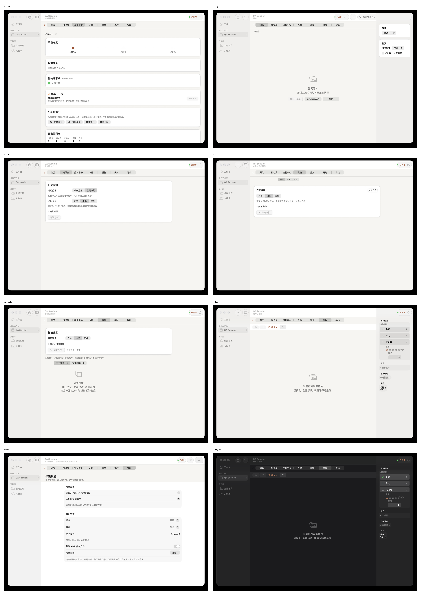

# 会话页 Phase 2-4 执行记录（2026-10-24）

> 对应方案：[外观与交互的宏观架构评审](appearance-interaction-architecture-2026-10-24.md)
> 范围：会话页 scaffold、路由模型、命令中心、声明式事件/生命周期。
> 前置：[第一里程碑执行记录](appearance-m1-execution.md)。

## 1. 对原方案的修正

| 原方案 | 最终实现 | 原因 |
| --- | --- | --- |
| 用浏览器式 RouteHistory 替换单槽返回 | 保留现有产品语义：图库/相似度返回=进入前页面；从图库/相似度切普通页签后再返回先回图库/相似度；普通页签切换不改变返回目标；无页级来源时离开会话 | 现有测试锁定这些语义；改成历史栈会回归 |
| `GatherSessionPage` 接管 toolbar/inspector | 接管页签/返回/背景/副标题/生命周期；toolbar 收口到 GatherSessionToolbar，inspector 仍每页提供 | C1/刷新/页内动作差异大；先收确定性部分 |
| 一次性删 `SessionTab` / `Destination` | `SessionPage`/`AppRoute` 是唯一真相源；`Destination`/`SessionTab` 保留为测试/控制中心模型的兼容投影 | 避免 640 个测试和控制中心模型一次性重写 |
| 菜单命令直接接到全局单例 | `AppCommandCenter` 由 `AppBootstrap.SceneState` 持有，RootView 安装 handler；SwiftUI Commands 调用它 | 不引入全局可变单例；scene 生命周期清晰 |
| 所有事件一次迁到 AsyncStream | 保留 NotificationCenter 载荷；新增 3 个声明式 modifier | 不重写总线，先删页面重复的 guard/debounce |

## 2. 代码结构

### Interaction 新层

| 文件 | 职责 |
| --- | --- |
| `Interaction/SessionPage.swift` | 7 个会话页面的唯一身份（gallery/similarity/control/faceKw/duplicates/culling/export） |
| `Interaction/AppRoute.swift` | 全局页 + 会话页目的地 |
| `Interaction/NavigationEnvironment.swift` | `\.navigator` environment（RootView 注入） |
| `Interaction/GatherSessionPage.swift` | 会话页骨架 + `GatherSessionTabStrip`（7 段页签、窄窗菜单、返回、生命周期） |
| `Interaction/AppCommandCenter.swift` | 菜单/快捷键命令中心（handler + canPerform） |
| `Interaction/DomainEvents.swift` | `refreshOnDomainEvents` / `handleDomainEvents` / `refreshOnJobTerminal` |

### 路由

- `RootNavigation` 内部以 `route: AppRoute` 为唯一状态；
  `Destination` / `SessionTab` 是兼容投影。
- `RootView` / `RootShellWorkspace` / `RootShellSidebar` 改用 `AppRoute` 驱动
  workspace 生命周期、意图失效、侧栏高亮。
- 导航方法：`open(_ page:in:)`、`openGallery(photoId:path:)`、
  `openGalleryOffline`、`openFaceAnalyze`、`openFaceRole`、`openCullingConflicts`、
  `openExport(intent:)`。
- 入口意图仍由 `WorkspaceIntent` 承载；RootView 把 navigator 的 intent sink 接到
  `SessionStore.workspace(for:).enqueue`。

### 页面

- 7 个会话页全部改为：

```swift
GatherSessionPage(page: .culling, workspace: workspace, subtitle: l10n("挑片与写回")) {
    content
}
.toolbar { ... }
.inspector { ... }
```

- 删除了页面级 `sessionPageChrome`、页签/返回闭包、只做 `setPageVisible` 的
  onAppear/onDisappear；页面 init 收敛为 `(workspace:culling:)`。
- 删除 `Support/SessionTabBar.swift`（旧 7 段页签 + 手写 chrome）；
  删除 `SessionTabRouter`（9 个导航闭包）。

### 命令

- GatherAppCommands 主路径调用 AppCommandCenter.perform；handler 未安装时对
  import/C1 等项回退旧通知，避免 bootstrap 早期菜单静默失效。
- `AppBootstrap` 持有 `commandCenter` 并随 `SceneState` 注入 RootView。
- RootView `installCommandHandlers()` 接：新建工作区、导入文件夹、C1 导入、
  侧栏显隐、打开设置。
- AppDelegate 的 AppKit 菜单兜底仍保留（SwiftUI 菜单被覆盖时使用），
  但正常路径已走命令中心。

### 事件

- Library / Gallery / ControlCenter / Persons / Settings 的 `domainChanged`
  改为 `refreshOnDomainEvents`；Culling 用 `handleDomainEvents` 保留 change 载荷。
- Library / Gallery / ControlCenter 的 `jobTerminal` 改为 `refreshOnJobTerminal`。
- 页面手写 `onReceive(NotificationCenter…)` 从 21 降到 12；
  总订阅数 27 → 21（含 RootView 菜单 6 + Interaction 3）。

### QA 入口

- DEBUG-only `--ui-page` 扩展为会话页 rawValue；
  新增 `--ui-session <id>` 直接打开已有工作区。
- 截图用隔离 DB，直接插入空工作区 `qa1`；不触碰用户真实 DB。

## 3. 验证

| 检查 | 结果 |
| --- | --- |
| `swift build`（debug） | ✅ |
| `swift build -c release` | ✅ |
| `swift test --no-parallel` | ✅ **640 tests / 72 suites** |
| `LayoutBudgetTests` | ✅ 含新 `GatherSessionPage` 页签行预算 |
| `ThemeContrastTests` | ✅ 5/5 |
| `check-design-system.sh` | ✅ theme legacy alias 27→18（baseline 已收紧） |
| `check-docs --strict` | ✅ |
| layering / preview / test catalog / cleanup / duplicates / no-legacy / protocol / select-star | ✅ |
| 截图 | ✅ 7 页浅色 + Culling 深色 |



详见 [assets/appearance-m2-m4/README.md](assets/appearance-m2-m4/README.md)。

**截图发现并修复的 bug**：`GatherSessionPage` 第一版 VStack 在空内容页被垂直居中，
挑片页签行跑到窗口中间；已用 `frame(..., alignment: .topLeading)` 修复并重截。

## 4. Review 修复（2026-10-24）

5 个只读审查子代理覆盖路由/生命周期、三组会话页、命令/事件、独立完整性验证。
独立验证：debug/release build、640 tests、全部门禁通过。修复项：

| 审查发现 | 修复 |
| --- | --- |
| P0：图库/相似度之后切普通页签，previousRoute 变脏，返回落错 | open(_:in:) 从图库/相似度离开时记录页级来源；goBack 所有分支先清 previousRoute；新增 2 条回归测试 |
| P1：Culling 空态被 topLeading 顶到上方 | emptyGuide 自己撑满并居中；页签行仍贴顶 |
| P1：Library/Gallery 事件双层 debounce 约 1s | 这两页的 modifier 传 debounce: .zero，只保留 VM 的单层合并 |
| P1：菜单在 handler 未装时静默无操作 | GatherAppCommands 在 canPerform == false 时回退旧通知（import/C1 在 bootstrap 期仍可用） |
| P1：意图/导航双入口 + 4 个死方法 | 删除 RootShellWorkspace 的 4 个未用入口；openGallery 统一走 navigator；新增 clearIntent sink 清旧照片意图 |
| P2：CommandCenter handler 永不清理 | RootView onDisappear 调 clearHandlers() |
| P2：空副标题/窄窗菜单分组/页签 padding | 复用 GatherPageSubtitle；窄窗菜单补分组 Divider；padding 进 GatherChromeMetrics |

### P2 收口

- 共享工具栏：新增 GatherSessionToolbar，7 页迁移（C1 + 可选刷新/设置）；
  Control/Face 的 @State VM 在 ToolbarContent 闭包复制时触发 SIGSEGV，改 @Bindable 修复。
- 删除 Destination / SessionTab 兼容层；测试与 SessionControlModels 改用
  AppRoute / SessionPage；SessionTabHost.swift 改名 SessionPageHost.swift。
- 测试：DomainEventFilter 3 条、command clearHandlers 1 条、
  N01 最小窗口检查器预算 1 条；全量 640 tests / 72 suites。
- 截图：7 页浅色 + Culling 深色用 P2 构建重拍，contact.png 更新；
  另补 860×560 与 Culling 高对比。
- N01：860×560 截图复现 AppKit 约束循环；页签行改 GeometryReader 门控
  （窄窗 Menu，最小宽度 61），inspector ideal 260→220，并加预算回归测试。

仍未完成（不阻塞本阶段，但 Phase 4 只算部分完成）：菜单 canPerform 禁用态、AppDelegate 单轨、
检查器共享、focused-scope 的 per-window 上下文（Culling undo/redo 仍只在页内按钮）、
英文/有数据/真实 workbench 截图。

## 5. 剩余风险 / 未完成

1. **检查器仍未共享**：GatherInspectorSection 未落；Culling 仍用 GroupBox，
   Gallery/Library 各写检查器卡片。
2. **测试缺口**：GatherSessionPage 真实挂载可见性测试因 NSHostingView/NSWindow
   在测试进程 SIGSEGV 未保留；LayoutBudgetTests 的 scaffold 用例仍用 Color.clear，
   但新增了“页签行 + 挑片内容 + 检查器”预算回归。
3. **AppDelegate 菜单兜底双轨**：正常路径走 CommandCenter；Delegate 的 AppKit 兜底
   也接入了 commandCenter，但 RootView handler 尚未安装时仍回退通知。要彻底单轨，
   需要把 handler 安装提前到 scene 发布前（或让 commandCenter 自身持有默认 handler）。
4. **菜单 canPerform 禁用态未实现**：handler 状态 @ObservationIgnored，菜单仍常启用；
   无 handler 时靠 GatherAppCommands 的旧通知回退，而不是禁用。
5. **截图只覆盖空数据**：860×560 与 Culling 高对比已补；有照片/分组/任务、
   英文、Culling workbench/胶片/对比仍未截图。
6. **交互点击未自动化**：本机辅助功能/鼠标事件不可用；返回/页签语义靠 640 个测试，
   没有人工点击全流程。
7. **Culling 真实数据布局**：只截了空范围；workbench/胶片/对比模式仍需数据 fixture。
8. **多窗口未定义**：commandCenter 是 SceneState 级共享，handler 绑定单个 RootView；
   undo/redo 仍只在 Culling 页面按钮，没有 focused-scope 的 per-window 上下文。

## 6. 下一阶段

1. `GatherInspectorSection`：统一检查器卡片，替换 Culling 的 GroupBox；
2. AppDelegate 菜单兜底接 CommandCenter，删命令通知，补 canPerform 禁用态；
3. 860/en/high-contrast + 有数据截图矩阵；
4. 多窗口/focused-scope 的 per-window 命令上下文。
