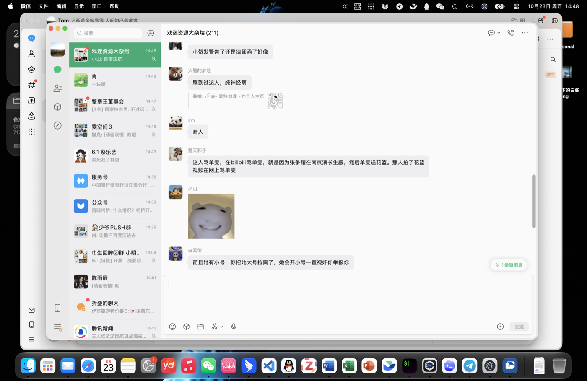
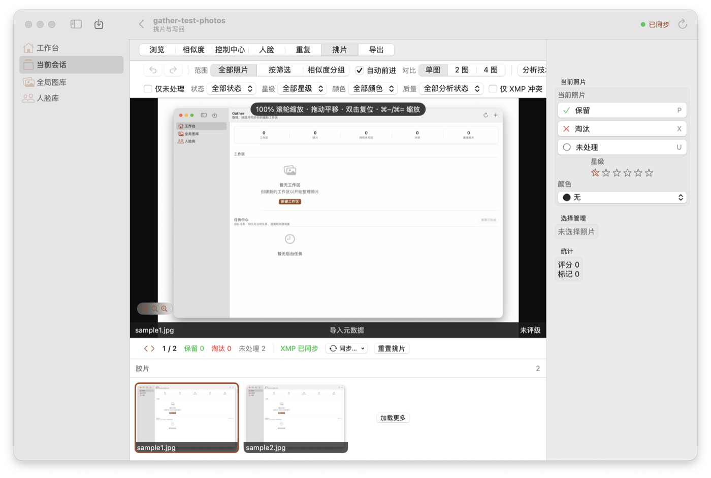
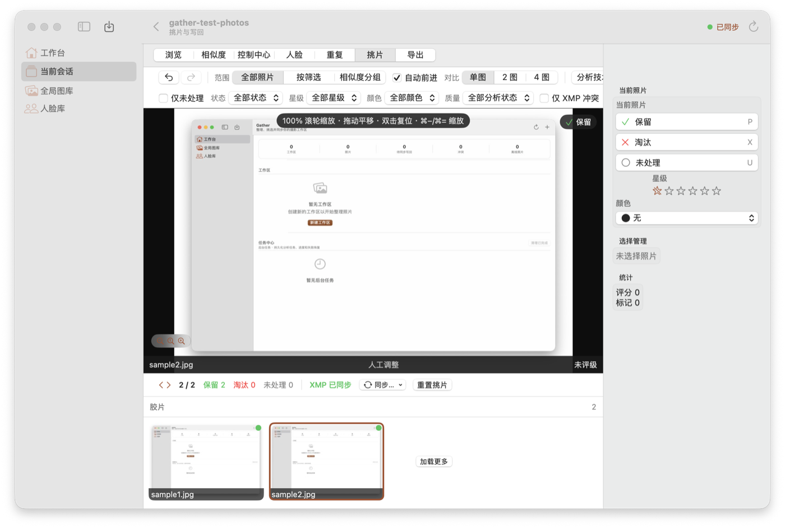

# 实机验收记录（2026-10-23）

## 环境

- macOS 27.0.1（Build 26A434），arm64。
- Xcode 27.1（27A9275），构建 SDK 27.0。
- 产物：`GATHER_ARCHS=arm64 GATHER_VERSION=3.0.0-acceptance OUTPUT_DIR=/tmp/gather-live ./desktop/native/build.sh`，未签名/未公证。
- App 通过 LaunchServices（`open -n`）启动，窗口 1180×780。

## 结果

- **首屏正常渲染**：工作台、全局图库、人脸库；统计 0 工作区/0 照片/0 待同步写回/0 冲突/0 离线照片；“新建工作区”“任务中心”空态显示正常。
- 进程持续运行 ≥30s，无崩溃、无初始化失败。
- 独立数据目录建库成功：`user_version=2`、**43** 表、**373** 列、**69** 普通索引、`PRAGMA foreign_key_check` 0 行。
- 图标：`Contents/Resources/AppIcon.icns` 存在，`CFBundleIconFile=AppIcon`。
- 截图：[2026-10-23-acceptance-workbench.png](2026-10-23-acceptance-workbench.png)。

## 发现

1. **旧库 fail-closed**：用户现有 `~/Library/Application Support/Gather/gather.sqlite` 是 `user_version=0` 且已有表。生产路径启动时按设计拒绝：
   `corrupt("库不可用（V1 之前的旧库（user_version=0 但已有表））: …/gather.sqlite")`，界面显示“初始化失败”。这是预期保护，不是本轮回归；使用当前构建前需归档/移除该旧库（`gather.sqlite` + `-wal` + `-shm`）。
2. 验收用隔离数据目录启动（`GatherApplicationSupportDirectory` 偏好覆盖，见 DEVELOPMENT），未读写用户真实库；用户库未被修改/移动。
3. 辅助功能权限可用，但宿主 DSH、微信等应用会反复抢回前台；合成键盘事件不稳定，鼠标/AX 点击只在 Gather 短暂置前时生效。

## 交互测试（2026-10-23 15:00）

- **导入**：通过 `gather://import?file=...` 深链导入 2 张 JPEG，`sessions=1`、`photos=2`，图库立即显示 2 张缩略图。
- **挑片**：切换到“挑片”页，通过 AX 点击“保留/淘汰/上一张”；数据库 `culling_decisions` 2 行均为 `keep`，`culling_history` 4 行，界面显示“保留 2 / 淘汰 0 / 未处理 0”。
- **写回未触发**：底部“同步…”菜单在抢焦点环境下无法稳定展开，`deliveries` / `delivery_intents` 仍为 0，未生成 `.xmp`。这是**交互自动化未完成**，不是已证实的应用失败；写回引擎由 core 全量测试覆盖（1,168 tests 全绿，含 `WritebackServiceTests`）。

## 未覆盖（外部）

- Developer ID 签名、notarytool 公证、staple、spctl（无证书/凭据）。
- macos-26/27 release CI 实跑（需 Xcode 26+、Capture One SDK、runner secrets）。
- x86_64 / Rosetta 运行（本机 `arch -x86_64` 不可用）。
- 导入→挑片→写回→导出的完整 GUI 流程：导入/挑片已实测；写回菜单未能在抢焦点环境下触发，导出/确认同步未测。
- 交互自动化本身受宿主焦点抢占影响；没有把“未触发”当成产品通过。
