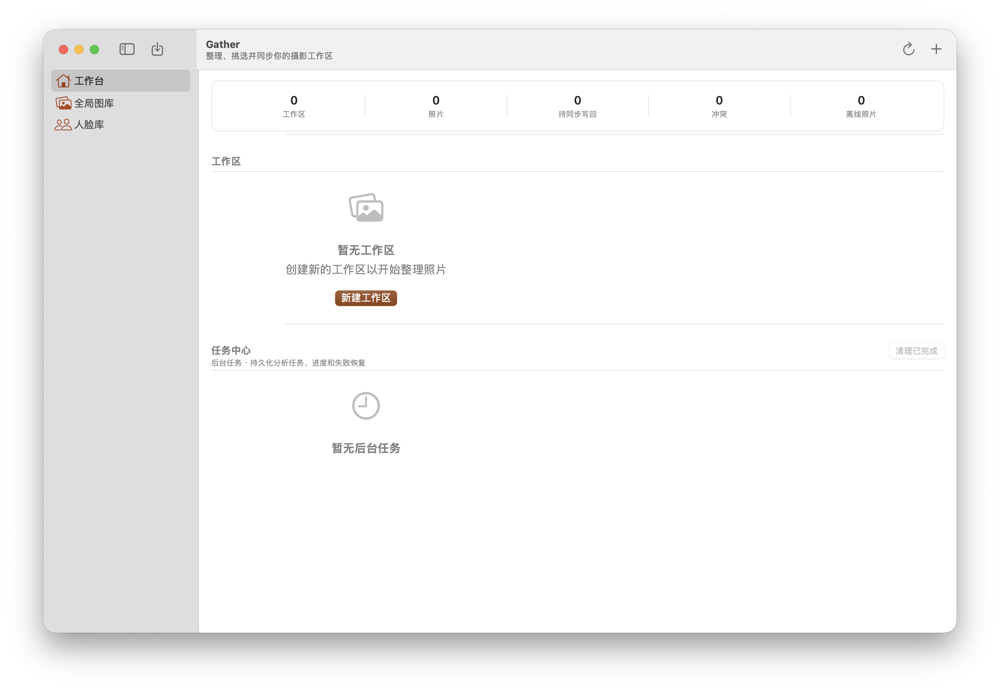

# 实机验收记录（2026-10-23）

## 环境

- macOS 27.0.1（Build 26A434），arm64。
- Xcode 27.1（27A9275），构建 SDK 27.0。
- 产物：`GATHER_ARCHS=arm64 GATHER_VERSION=3.0.0-acceptance OUTPUT_DIR=/tmp/gather-live ./desktop/native/build.sh`，未签名/未公证。
- App 通过 LaunchServices（`open -n`）启动，窗口 1180×780。

## 结果

- **首屏正常渲染**：工作台、全局图库、人脸库；统计 0 工作区/0 照片/0 待同步写回/0 冲突/0 离线照片；“新建工作区”“任务中心”空态显示正常。
- 进程持续运行 ≥30s，无崩溃、无初始化失败。
- 独立数据目录建库成功：`user_version=2`、**43** 表、**373** 列、**69** 普通索引、`PRAGMA foreign_key_check` 0 行。
- 图标：`Contents/Resources/AppIcon.icns` 存在，`CFBundleIconFile=AppIcon`。
- 截图：[2026-10-23-acceptance-workbench.png](2026-10-23-acceptance-workbench.png)。

## 发现

1. **旧库 fail-closed**：用户现有 `~/Library/Application Support/Gather/gather.sqlite` 是 `user_version=0` 且已有表。生产路径启动时按设计拒绝：
   `corrupt("库不可用（V1 之前的旧库（user_version=0 但已有表））: …/gather.sqlite")`，界面显示“初始化失败”。这是预期保护，不是本轮回归；使用当前构建前需归档/移除该旧库（`gather.sqlite` + `-wal` + `-shm`）。
2. 验收用隔离数据目录启动（`GatherApplicationSupportDirectory` 偏好覆盖，见 DEVELOPMENT），未读写用户真实库；用户库未被修改/移动。
3. 本环境无可用的辅助功能权限，合成点击未生效；因此本轮只覆盖**启动与首屏**，未执行新建工作区/导入/写回等交互。

## 未覆盖（外部）

- Developer ID 签名、notarytool 公证、staple、spctl（无证书/凭据）。
- macos-26/27 release CI 实跑（需 Xcode 26+、Capture One SDK、runner secrets）。
- x86_64 / Rosetta 运行（本机 `arch -x86_64` 不可用）。
- 完整的导入→挑片→写回 GUI 流程（需真实照片与交互自动化）。
